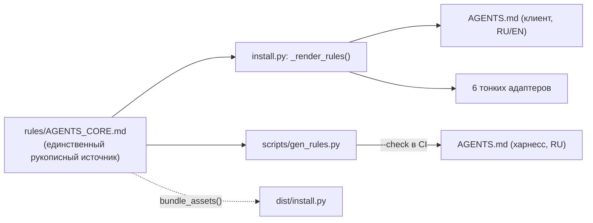

# 📋 План: PLAN-022 — Фаза 22: Компилятор правил единого источника и защита от дрейфа SSOT

> **ID:** PLAN-022 | **Статус:** Согласовано (2026-10-18)  
> **Фаза:** 22 | **Целевой релиз:** v0.22.0  
> **Спецификация:** [[../../SPEC|SPEC.md]] | **Канбан:** [[../Kanban|Канбан]] | **Дорожная карта:** [[../Roadmap|Дорожная карта (Фаза 22)]]  
> **Нормативная база:** ADR-0030 (оформляется в рамках TASK-085 как фиксация принятого решения, а не «бумажная архитектура») | **Источник:** пункт Icebox «Single-Source Rule Compiler»

---

## 1. Контекст и цели (Problem & Goals)

### Проблема: три независимых инвентаря правил агента

Правила поведения AI-агента сегодня существуют в трёх местах, которые поддерживаются вручную и **уже разошлись**:

| Артефакт | Инвентарь | Язык | Фактическое состояние |
| :--- | :--- | :--- | :--- |
| Корневой `AGENTS.md` | 16 нумерованных принципов + lifecycle | RU | Эталон разработки харнесса |
| `install.py: _RULES_BODY` | 20 дисциплин + 11 присоединяемых секций | EN | **4 правила дублируются дословно** (Single-Task Barrier, Zero-State/Spec Genesis, The 4-State UI, Anti-Echo) |
| `install.py: _gen_rule()` | 10 компактных правил для 6 адаптеров | EN | Третий, независимый инвентарь |
| Governance-контур | `TechDebt`, `Prior-Art Gate`, `Traceable tags`, `Benchmarks` | EN | **Отсутствуют** в нумерованном списке 20 — живут только секциями |

Дополнительные дефекты, выявленные при инспекции:

1. **Числовой литерал в заголовке.** Заголовок `## Docs-as-Code (20 Disciplines)` хардкодит количество правил: добавление 21-го правила делает заголовок ложью, а тесты — зелёными только потому, что ассертят ту же строку.
2. **Правила-сироты.** Правила 13, 14, 20 из `_RULES_BODY` повторяют одноимённые секции ниже в теле `generate_agents_md()`, но в сокращённой редакции — правка одной копии не доезжает до второй.
3. **Ручная синхронизация как источник регрессий.** Каждая фаза, добавлявшая правило (TASK-069, TASK-070, TASK-083, TASK-084), порождала отдельную задачу «синхронизировать правила в `install.py`», то есть стоимость правила = 3–4 правки в разных файлах.

### Цель Фазы 22

Превратить правила агента в **компилируемый артефакт**: единственный рукописный корпус правил → детерминированный рендер всех потребителей (`AGENTS.md` харнесса, `AGENTS.md` клиента, 6 тонких адаптеров) → механический Tier 1 контроль дрейфа в CI.

### Метрика успеха (проверяемая)

* Новое правило = **1 правка** (корпус), а не 3–4.
* **0** дублирующихся формулировок в сгенерированных артефактах (проверяется тестом).
* `python scripts/gen_rules.py --check` → exit 0 на чистом дереве, exit 1 после ручной правки `AGENTS.md`.
* Паритет RU/EN: идентичный набор `RULE-ID` в обеих языковых ветках.
* `deploy_infrastructure()` не кладёт корпус в `docs/` клиентского проекта (корпус не является шаблоном заметки).

---

## 2. Обсуждение и решения (Q&A)

* **Q1: Где живёт канонический источник?**
  * **Решение:** новый файл `rules/AGENTS_CORE.md` — Markdown с блоками `<!-- RULE:<ID> | adapter: "..." --> ... <!-- /RULE -->`, языковыми ветками `<!-- LANG:ru -->` / `<!-- LANG:en -->` и плейсхолдерами `{{project}}`, `{{stack_name}}`, `{{build_cmd}}`, `{{test_cmd}}`, `{{lang_instruction}}`.
  * **Отклонено:** компиляция напрямую из корневого `AGENTS.md` (исходная формулировка Icebox). Причины: файл целиком русскоязычный и содержит контекст разработки самого харнесса; его дословный рендер утёк бы в клиентские проекты, а обрезка «лишнего» строковыми заменами — тот же хрупкий дрейф, только перенесённый в код.
* **Q2: Где живёт рендерер?**
  * **Решение:** внутри `install.py` как приватный слой (`_load_rules_corpus()`, `_render_rules()`, `_render_adapter_rules()`); `generate_agents_md()` и `_gen_rule()` сохраняют публичные сигнатуры и делегируют ему. Монолит обязан остаться single-file (Zero-Deps-распространение).
  * **Отклонено:** вынесение парсера в `scripts/kb_rules.py` — дистрибутив запускает `install.py` до развёртывания `scripts/`, импорт недоступен; копия парсера в двух файлах воспроизвела бы устраняемую проблему.
* **Q3: Является ли корневой `AGENTS.md` генерируемым артефактом?**
  * **Решение (Вариант A, полный SSOT):** да. `scripts/gen_rules.py` рендерит корневой `AGENTS.md` из корпуса в профиле `harness` (RU); ручные правки запрещены, файл помечается шапкой «GENERATED — edit `rules/AGENTS_CORE.md`». Идемпотентность контролируется флагом `--check`.
* **Q4: Как быть с 6 тонкими адаптерами (`GEMINI.md`, `CLAUDE.md`, `.cursorrules`, `.windsurfrules`, `.clinerules`, `copilot-instructions.md`)?**
  * **Решение:** адаптеры остаются Thin Forwarders (ADR-0021), но их компактный список **выводится** из метаданных `adapter:` тех же блоков корпуса. Отдельных рукописных формулировок для адаптеров больше нет — третий инвентарь исчезает.
* **Q5: Что если корпус недоступен (повреждённый бандл/запуск вне репозитория)?**
  * **Решение:** **жёсткая ошибка** (`RuntimeError` с actionable-сообщением), без «тихого» fallback на встроенную копию правил. Тихий fallback воссоздал бы дрейф именно в момент, когда его сложнее всего заметить.
* **Q6: Куда встроить `--check` в CI, если `bundle_assets()` пакует все `.github/workflows/*.yml` в клиентские проекты?**
  * **Решение:** добавить `.github/workflows/rules-check.yml` (триггеры `push`, `pull_request`) **и** явный exclusion-список в `scripts/build_installer.py`, чтобы харнесс-специфичный workflow не уезжал в клиентские проекты (там нет `rules/`). Дополнительно `--check` добавляется в префлайт `release.yml`.
* **Q7: Что делать с хардкодом «20 Disciplines» в заголовке?**
  * **Решение:** убрать числовой литерал — заголовок становится `## Docs-as-Code Disciplines`. Само число перестаёт быть данными, которые надо синхронизировать. Тесты, ассертящие литерал, переводятся на проверку набора `RULE-ID`.
* **Q8: Ломается ли обратная совместимость `install.py --update`?**
  * **Решение:** нет. `update_agent_rules_safe()` уже сравнивает содержимое и создаёт `.bak` при расхождении; рендер детерминирован, поэтому при неизменном корпусе `.bak` не появляется. Регрессия покрывается существующим E2E-тестом update-механизма.

---

## 3. Архитектурное влияние и риски

### Затрагиваемые компоненты

`rules/AGENTS_CORE.md` (новый), `scripts/gen_rules.py` (новый), `install.py` (`_RULES_BODY`, `_gen_rule`, `generate_agents_md`, `unpack_assets`, `deploy_infrastructure`), `scripts/build_installer.py`, `AGENTS.md` (становится генерируемым), `.github/workflows/rules-check.yml` (новый), `.github/workflows/release.yml`, `tests/test_rules_consistency.py` (новый), `tests/test_installer.py`, `SPEC.md`, `README.md`, `docs/Onboarding.md`, `docs/00_Templates/*` (упоминания «20 disciplines» при наличии).

### Поток данных

### Prior-Art Gate

* **Внутренний аудит:** `unpack_assets()` уже реализует паттерн «бандл → local-fallback», а `customize_templates_for_stack()` — подстановку плейсхолдеров; новый слой переиспользует оба механизма вместо изобретения шаблонизатора. `deploy_infrastructure()` маршрутизирует ассеты по префиксам и игнорирует неизвестные ключи — значит `rules/` не попадёт в `docs/`.
* **Внешний аудит:** Markdown не имеет нативного `include`. Готовые решения (Sphinx `include`, Jekyll ``, Jinja2, Mako) требуют внешних зависимостей и нарушают ADR-0001 (Zero Dependencies). Детерминированный codegen с `--check` — идиоматичный для stdlib путь.

### Риски и митигация

| Риск | Влияние | Митигация |
| :--- | :--- | :--- |
| Миграция корневого `AGENTS.md` теряет нюанс (Always-On префикс меняет поведение агента) | Высокое | Дифф мигрированного файла ревьюится в сессии до коммита; корпус собирается как объединение 16 + 20 + 11 формулировок с дедупликацией |
| Рассинхронизация RU/EN-веток корпуса | Среднее | Tier 1 тест паритета `RULE-ID` |
| Ручная правка `AGENTS.md` агентом в будущей сессии | Среднее | `--check` в CI (exit 1) + шапка GENERATED + запись в `docs/Onboarding.md` |
| `rules-check.yml` утекает в клиентские проекты | Среднее | Явный exclusion в `bundle_assets()` + E2E-тест «в бандле нет rules-check.yml» |
| Python 3.8-совместимость (парсер блоков) | Низкое | Только `re`/`str`; прогон тестов на 3.8-совместимом синтаксисе |

### The 4-State UI Matrix

Не применимо: задача не затрагивает GUI/TUI. Поведение CLI не меняется, единственный новый пользовательский интерфейс — текстовое сообщение об ошибке отсутствующего корпуса, которое формулируется как actionable-инструкция.

### Отвергнутые альтернативы

* **Компиляция из корневого `AGENTS.md`** — см. Q1.
* **Jinja2/Mako как шаблонизатор** — нарушение Zero-Deps (ADR-0001).
* **Две отдельные билингвальные копии корпуса (`*_ru.md` / `*_en.md`)** — паритет языков станет новой зоной дрейфа, которую придётся синхронизировать вручную.
* **Хранение правил в Python-структуре (`dict`)** — теряется читаемость в Obsidian и diff-дружелюбность ревью.
* **Сохранить ручной `AGENTS.md` + только ID-сверка (Вариант B)** — дрейф остаётся возможным, устраняется лишь его обнаружение.

---

## 4. Декомпозиция задач (Task Breakdown)

- [ ] **TASK-085:** Корпус правил `rules/AGENTS_CORE.md`, рендерер в `install.py` и упаковка в бандл.
  * Блоки `RULE`/`LANG`/`adapter:`, плейсхолдеры, дедупликация 16 + 20 + 11 формулировок.
  * `_load_rules_corpus()` (бандл → local-fallback → `RuntimeError`), `_render_rules()`, `_render_adapter_rules()`; рефакторинг `_RULES_BODY`, `_gen_rule()`, `generate_agents_md()`.
  * `scripts/build_installer.py`: ключ `rules/AGENTS_CORE.md` в бандле + exclusion `rules-check.yml`.
  * ADR-0030 (`status: accepted`) с фиксацией отвергнутых вариантов.
- [ ] **TASK-086:** Генерация корневого `AGENTS.md` и CI-гейт.
  * `scripts/gen_rules.py` (рендер профиля `harness`, `--check`), миграция `AGENTS.md` с ревью диффа.
  * `.github/workflows/rules-check.yml` + шаг `--check` в префлайт `.github/workflows/release.yml`.
- [ ] **TASK-087:** Tier 1 тесты дрейфа (`tests/test_rules_consistency.py`).
  * Уникальность `RULE-ID`, паритет RU/EN, отсутствие дублей в отрендеренных артефактах, выводимость адаптеров, идемпотентность `--check`, «hard error без корпуса».
- [ ] **TASK-088:** E2E-синхронизация, Living Spec и пересборка монолита.
  * `tests/test_installer.py` (замена ассертов «20 Disciplines»), `build_installer.py`, `dist/install.py`, `SPEC.md`, `README.md`, `docs/Onboarding.md`.

---

## 5. Критерии приемки плана (DoD Режима 1)

- [ ] Концепция согласована с пользователем (READ-ONLY, без кода) — подтверждено 2026-10-18.
- [ ] Дорожная карта `Roadmap.md` обновлена (Фаза 22, Icebox очищен).
- [ ] Карточка добавлена в `Kanban.md` в `📥 Бэклог`.
- [ ] Целостность подтверждена через `scripts/kb_lint.py`.
