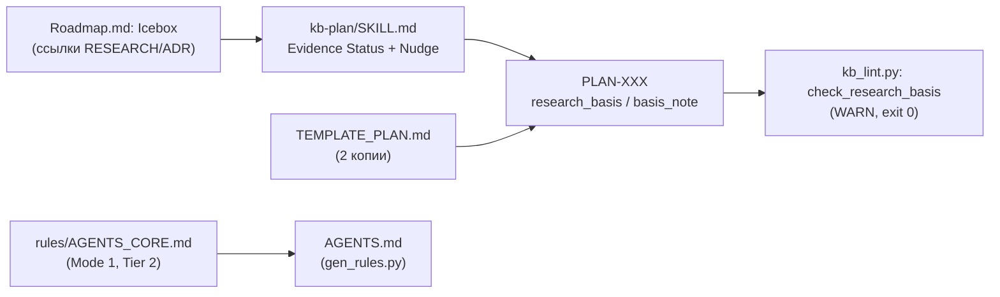

# 📋 План: PLAN-023 — Фаза 24: Research-Evidence Gate при промоушене из Icebox

> **ID:** PLAN-023 | **Статус:** Согласовано (2026-10-18)  
> **Фаза:** 24 | **Спецификация:** [[../../SPEC|SPEC.md]] | **Канбан:** [[../Kanban|Канбан]] | **Дорожная карта:** [[../Roadmap|Roadmap (Фаза 24)]]  
> **Нормативная база:** [[../../04_Research/RESEARCH-025-research-evidence-gate-for-icebox-promotion|RESEARCH-025]], [[../../03_Decisions_ADR/ADR-0031-research-evidence-gate-for-icebox-promotion|ADR-0031]], [[../../03_Decisions_ADR/ADR-0025-self-improving-defect-loop-and-quality-gates|ADR-0025]]  
> **Источник:** пункт Icebox «Research-Evidence Gate при промоушене из Icebox» (🔥 высокий Value Impact / Effort S)

---

## 1. Контекст и цели (Problem & Goals)

### 1.1. Проблема: план, неотличимый от знания

Icebox в [[../Roadmap|Roadmap.md]] задуман как **выход** Режима 0: туда попадают только идеи, прошедшие стресс-тест (`RESEARCH-XXX`, при архитектурном влиянии — `ADR-XXXX`). Фактически секция наполняется вручную, а `/kb-plan` без аргументов не отличает валидированное направление от гипотезы: план получает ту же фазу, ту же декомпозицию и тот же DoD. Через одну-две фазы гипотеза становится частью архитектуры, а её происхождение восстановить невозможно.

Второй, более точный диагноз — **регресс уже принятого решения**, а не новый функционал: [[../../03_Decisions_ADR/ADR-0011-intent-routing-and-icebox-prioritization-in-kb-plan|ADR-0011]] §2.2 требует ранжировать кандидатов по *«Value Impact и технической зрелости (наличие `RESEARCH` и `ADR`)»*, но в `.agents/skills/kb-plan/SKILL.md` (ветка `No Argument`) остался только `value impact` — критерий зрелости утерян при переносе решения в текст скилла.

### 1.2. Измеренные факты (RESEARCH-025 §3)

| Замер | Значение | Что означает |
| :--- | ---: | :--- |
| Зрелость текущего Icebox (пункты со ссылкой на `RESEARCH`/`ADR`) | 1 из 8 (12,5%) | Комментарий-инструкция в шапке секции игнорируется — отказ Tier 3 без подпорки |
| Планы со ссылкой на `RESEARCH-XXX` в шапке | 17 из 22 (77%) | Модальный путь «исследование → план» работает; проблема в исключениях |
| Цена промпта (ветка `No Argument`) | +54 слова (+20% к On-Demand скиллу) | Укладывается в бюджет [[../../03_Decisions_ADR/ADR-0009-high-snr-token-architecture-and-context-efficiency|ADR-0009]] |

Живой кейс инверсии Double Diamond — [[PLAN-022-single-source-rule-compiler|PLAN-022]]: пункт Icebox был промоутирован в Фазу 22 без исследования, `ADR-0030` оформлялся уже после принятия решения. Качество анализа в плане высокое, но план **сам выполнил роль исследования, не объявив этого**; защитная фраза «как фиксация принятого решения, а не бумажная архитектура» — маркер того, что процессу не хватает явного поля.

### 1.3. Аудит реализации перед планированием (ни один элемент ADR-0031 не внедрён)

* `.agents/skills/kb-plan/SKILL.md` — критерий зрелости отсутствует; `Evidence Nudge` отсутствует.
* `docs/00_Templates/TEMPLATE_PLAN.md` и `templates/TEMPLATE_PLAN.md` — поля `research_basis` и секции «Research Basis & Unvalidated Assumptions» нет.
* `scripts/kb_lint.py` — проверки для `02_Tasks/Plans` нет; `Plans` вне `schemas`, поэтому поле не может стать обязательным.
* `rules/AGENTS_CORE.md` — строки про `research_basis` в Mode 1 нет.
* Поле уже живёт в живом виде у PLAN-022 (`research_basis: none` + `basis_note`) — то есть соглашение де-факто существует, но не зафиксировано в шаблоне.

### 1.4. Внеплановая находка: дрейф копий шаблонов (P2)

`templates/` (источник бандла для `scripts/build_installer.py` и local-fallback `unpack_assets()`) и `docs/00_Templates/` (хранилище базы знаний) **разошлись**:

| Файл | Расхождение | Последствие |
| :--- | :--- | :--- |
| `TEMPLATE_PLAN.md` | в `docs/` есть матрица 4 состояний (TASK-073), в `templates/` — нет | Клиенты получают план-шаблон без 4-State Matrix, хотя `FOUR-STATE-UI` — Always-On правило |
| `TEMPLATE_INDEX.md` | в `docs/` есть `Zero_To_Hero_Guide`, `Inbox/`, `06_Memory/`, «16 шаблонов»; в `templates/` — нет | Установленный клиент получает устаревшую карту заметок |

Дрейф не детектируется, потому что тесты читают `install.unpack_assets(REPO_ROOT)`, а корневой `install.py` — уже собранный монолит с `EMBEDDED_ASSETS_B64`, то есть тесты проверяют **снимок бандла**, а не параллельность двух копий. По протоколу TechDebt P1/P2 устраняются в том же проходе → включено в фазу как TASK-092 с Tier 1 parity-тестом.

### 1.5. Цель фазы и метрики успеха

Восстановить критерий зрелости и сделать доказательную базу плана **явной, durable и защищённой от повторной потери**: не блокируя пользователя, а оставляя след в артефакте.

* `/kb-plan` без аргументов на текущем Icebox показывает статус **каждого** кандидата; при выборе `🧪`-пункта выдаётся ровно один Nudge с тремя опциями.
* `research_basis` + `basis_note` присутствуют в шаблоне плана (обе копии) и в секции «Research Basis & Unvalidated Assumptions».
* `kb_lint.py`: план с `research_basis: none` без `basis_note` даёт `WARN:`, **не** ломая exit code; при отсутствии поля предупреждения нет.
* `python scripts/gen_rules.py --check` → exit 0; строка правила живёт в `rules/AGENTS_CORE.md`, а не в сгенерированном `AGENTS.md`.
* В установленном проекте `.agents/skills/kb-plan/SKILL.md` содержит `Evidence Nudge` (E2E), а `templates/` ≡ `docs/00_Templates/` (parity).

---

## 2. Обсуждение и решения (Q&A)

* **Q1: Как ранжировать, не превращая это в новую функцию?**
  * **Решение:** ветка `No Argument` получает второй критерий — **Evidence Status** (наличие связанных `RESEARCH-XXX`/`ADR-XXXX`), а каждый кандидат помечается `🔬` (валидировано), `🧪` (гипотеза) или `⏸` (parked). Пометки **вычисляются из ссылок** в строке Icebox, вручную в `Roadmap.md` не вносятся. Это восстановление ADR-0011 §2.2.
  * **Классификация `⏸`:** только при явных parking-маркерах в тексте пункта («на будущее», «когда наступит X», «после Фазы N») и отсутствии ссылок; иначе — `🧪`. `⏸` показывается в списке, но кандидатом для рекомендации не считается.
* **Q2: Почему Nudge, а не гейт?**
  * **Решение:** неблокирующий `Evidence Nudge` с тремя опциями: **(A)** узкий `/kb-research <topic>`; **(B)** план с обязательным разделом Research Basis; **(C)** сразу план. По умолчанию рекомендуем **A** для необратимых решений (внешние зависимости по ADR-0001, публичные контракты, форматы данных, миграции, безопасность) и **B** для обратимых. Выбор пользователя абсолютен; Nudge не повторяется в рамках сессии.
  * **Отклонено:** жёсткий гейт и авто-запуск `/kb-research` — нарушают Human Guardrails ([[../../03_Decisions_ADR/ADR-0022-chat-first-vibe-coder-dx-and-human-guardrails|ADR-0022]]) и расходуют время пользователя без согласия (полный разбор — ADR-0031 §3).
* **Q3: Как объявить поле в шаблоне?**
  * **Решение (подтверждено пользователем):** в `TEMPLATE_PLAN.md` — **закомментированные подсказки** (`# research_basis: "[[...RESEARCH-XXX...]]" | none` + `# basis_note: ...`). Поле остаётся опциональным для 22 существующих планов, а линтер молчит, когда поля нет. Агент обязан заполнить поле при промоушене из Icebox (следствие R2), но шаблон не навязывает `none` каждому новому плану.
  * **Отклонено:** активные `research_basis: none` + пустой `basis_note` в шаблоне — каждый свежий план получал бы `WARN` с первого дня (шум, привыкание к предупреждениям).
* **Q4: Контракт линтера и обратная совместимость.**
  * **Решение:** новая функция `check_research_basis(docs_dir)` сканирует `02_Tasks/Plans/**/*.md` (пропуская `TEMPLATE_*`) и возвращает **только** строки `WARN:`; они агрегируются как неблокирующие (прецедент — `debt_warnings` и `check_memory_consistency`). Правило: если `research_basis` присутствует и нормализуется в `none` (без учёта регистра, кавычек и inline-комментария) — требуется непустой `basis_note`. `Plans` **не** добавляется в `schemas`.
* **Q5: Где живёт Tier 2 правило?**
  * **Решение:** одна содержательная строка внутри Mode 1 в `rules/AGENTS_CORE.md` — в обоих документах корпуса (`client-agents` — для клиентских проектов, `harness-agents` — для этого репозитория), затем регенерация `AGENTS.md` через `scripts/gen_rules.py`.
  * **Ограничение:** новый блок `<!-- RULE: ... -->` **не создаётся** — иначе придётся править три пина инвентаря в `tests/test_rules_consistency.py` и subset-проверку адаптеров. Правка идёт внутрь существующего `LIFECYCLE`.
* **Q6: Нужен ли `research_basis` в `TEMPLATE_TASK.md`?**
  * **Решение:** нет. Доказательная база принадлежит плану/фазе, задача её наследует; дублирование создаст два источника правды (закрывает открытый вопрос RESEARCH-025).
* **Q7: Что с дрейфом `templates/` ↔ `docs/00_Templates/`?**
  * **Решение (подтверждено пользователем):** включить в фазу как TASK-092 — синхронизировать две копии и добавить Tier 1 тест паритета. Мы и так правим `TEMPLATE_PLAN.md` в обеих копиях в TASK-091, а blind spot («тесты читают бандл, а не хранилище») должен закрываться механически.
* **Q8: В каком порядке править скилл, тесты и монолит?**
  * **Решение:** ассерт `Evidence Nudge` в первой задаче читает **файл-источник** `.agents/skills/kb-plan/SKILL.md` напрямую, чтобы suite оставался зелёным до пересборки; проверка на **установленном** артефакте (deployed skill и `dist/`) выполняется в TASK-093 после `scripts/build_installer.py`. Иначе промежуточные задачи оставляли бы красный тест до конца фазы.

### 2.1. Research Basis & Unvalidated Assumptions

* **Известно (проверено инспекцией кода 2026-10-18):** текущий текст ветки `No Argument` в `kb-plan/SKILL.md`; отсутствие поля в обеих копиях шаблона; отсутствие проверки в `kb_lint.py` и `Plans` вне `schemas`; состав корпуса правил (3 документа, пин-инвентари в `tests/test_rules_consistency.py`); механика бандла (`EMBEDDED_ASSETS_B64` перекрывает local-fallback, поэтому тесты видят снимок); расхождение 2 из 17 шаблонов; прецедент неблокирующего `WARN:` (`debt_warnings`).
* **Не проверено (гипотезы) и как закрываем:**
  * **H1:** агент устойчиво применяет прозу Nudge без внешнего состояния → проверка — dry-run на текущем Icebox в TASK-090 + durable-след в TASK-091.
  * **H2:** классификация `⏸` не даёт ложных отнесений → первый прогон ранжирования документируется в TASK-090 как контрольный пример.
  * **H3:** advisory-проверка не даёт ложных `WARN` на 23 существующих планах → прогон `kb_lint` по репозиторию до коммита (acceptance-критерий задачи).
  * **H4:** parity-тест не выявит дополнительных расхождений, кроме двух известных → он их и выявит, если есть; синхронизация входит в TASK-092.
* **Обратимость:** изменения локальны (текст скилла, шаблон, одна проверка линтера, строка корпуса), внешних зависимостей не добавляют; откат — возврат файлов из истории. Поэтому полноценный Режим 0 не требуется — он уже выполнен (RESEARCH-025 + ADR-0031).

---

## 3. Архитектурное влияние и риски

### Затрагиваемые компоненты

`.agents/skills/kb-plan/SKILL.md`, `rules/AGENTS_CORE.md` (+ регенерация `AGENTS.md`), `docs/00_Templates/TEMPLATE_PLAN.md`, `templates/TEMPLATE_PLAN.md`, `docs/00_Templates/TEMPLATE_INDEX.md`, `templates/TEMPLATE_INDEX.md`, `scripts/kb_lint.py`, `tests/test_kb_lint.py`, `tests/test_installer.py`, `install.py` + `dist/install.py` (пересборка), `SPEC.md`, `README.md`, `docs/Onboarding.md`.

### Поток данных

### Prior-Art Gate

* **Внутренний аудит:** Nudge-механизм уже существует (`Pre-flight Nudge`, `Spec Genesis Check`) — новая ветка встраивается в него, а не создаёт второй механизм; секция Prior-Art Gate и 4-State Matrix уже есть в шаблоне; разделение `ERROR`/`WARN:` уже отработано в `check_tech_debt_integrity` и `check_memory_consistency`; пин-инвентарь правил и golden-фикстуры уже защищают корпус.
* **Внешний аудит (без переноса зависимостей):** Definition of Ready (жёсткий гейт — отклонён, см. ADR-0031 §3), XP Spike (аналог «узкого `/kb-research`»), Shape Up «shaping before betting» (разделение «де-рисковать агент» / «ставить пользователь»), ADR-статус `proposed` до реализации. Полный разбор — RESEARCH-025 §1.3.
* **Почему пишем своё:** механизм использует только существующие stdlib-возможности (`re`, `pathlib`) и Markdown-артефакты; внешний трекер доказательной базы нарушил бы Docs-as-Code и Zero-Deps.

### Риски и митигация

| Риск | Влияние | Митигация |
| :--- | :--- | :--- |
| Привыкание к Nudge (шум) | Среднее | Сообщение только для `🧪` и один раз за сессию; durable-след в плане важнее сообщения |
| Бюрократизация обратимых задач | Среднее | Опция **B** + `basis_note` в одну строку; Fast-Track микрозадач не затрагивается |
| Ложные `WARN:` в клиентских проектах | Среднее | Проверка срабатывает только при явном `research_basis: none`; отсутствие поля молчит |
| Повторная потеря формулировки при рефакторинге скилла | Высокое | Tier 1 ассерт `Evidence Nudge` (источник + deployed артефакт) |
| Дрейф копий шаблонов в будущем | Среднее | Parity-тест TASK-092 (Tier 1), а не ручная дисциплина |
| Расхождение `AGENTS.md` и корпуса | Высокое | Регенерация через `scripts/gen_rules.py` + существующий `rules-check.yml` |

### The 4-State UI Matrix

Не применимо: фаза не затрагивает GUI/TUI. Единственный пользовательский интерфейс — текстовое сообщение Nudge в чате (≤ 3 строки, три опции) и строка `WARN:` в выводе линтера; интерактивных состояний Empty/Loading/Error/Populated у них нет. Артефактов `docs/assets/mockups/` фаза не требует.

### Отвергнутые альтернативы

Полный перечень с обоснованиями — ADR-0031 §3 и RESEARCH-025 §5 (жёсткий гейт, авто-запуск Режима 0, ретроактивное заполнение поля, ручные бейджи в строках Icebox, отдельный JSON-реестр доказательной базы, «research-in-plan» как единственный механизм, «lazy ADR» как норма). Дополнительно отклонено в рамках планирования:

* **Отдельный `BUG-XXX` на дрейф шаблонов вместо TASK-092** — дисциплина сохранена, но дефект касается файла, который правится в этой же фазе, а blind spot остался бы без механического закрытия.
* **Новый блок `<!-- RULE: RESEARCH-EVIDENCE -->`** — дублировал бы требование внутри `LIFECYCLE` и потребовал бы править пины инвентаря во всех трёх документах корпуса.

---

## 4. Декомпозиция задач (Task Breakdown)

- [ ] `TASK-090` — **Skill & Tier 2**: `.agents/skills/kb-plan/SKILL.md` (критерий Evidence Status, пометки `🔬`/`🧪`/`⏸`, `Evidence Nudge` с опциями A/B/C и правилом рекомендации по обратимости; dry-run на текущем Icebox как контрольный пример) + строка правила в Mode 1 корпуса `rules/AGENTS_CORE.md` (`client-agents` и `harness-agents`) + регенерация `AGENTS.md` через `scripts/gen_rules.py` + Tier 1 ассерт `Evidence Nudge` по файлу-источнику в `tests/test_installer.py`.
- [ ] `TASK-091` — **Artifact & advisory lint**: `docs/00_Templates/TEMPLATE_PLAN.md` и `templates/TEMPLATE_PLAN.md` (закомментированные `research_basis`/`basis_note` + секция «Research Basis & Unvalidated Assumptions»: известно / не проверено / как закрываем) + `check_research_basis()` в `scripts/kb_lint.py` (неблокирующий `WARN:`, агрегация в verbose и Silent-on-Success ветках) + 4 теста в `tests/test_kb_lint.py` (`none` без заметки → `WARN` при exit 0; `none` с заметкой → чисто; ссылка на исследование → чисто; поле отсутствует → молчание).
- [ ] `TASK-092` — **Parity шаблонов (P2-находка §1.4)**: синхронизация `templates/TEMPLATE_PLAN.md` ↔ `docs/00_Templates/TEMPLATE_PLAN.md` и `templates/TEMPLATE_INDEX.md` ↔ `docs/00_Templates/TEMPLATE_INDEX.md` (перенос 4-State Matrix, `Zero_To_Hero_Guide`, `Inbox/`, `06_Memory/`, «16 шаблонов») + Tier 1 тест паритета всех `*.md` между двумя каталогами с сообщением о конкретном расхождении.
- [ ] `TASK-093` — **Bundle, E2E & Living Spec**: пересборка `install.py` и `dist/install.py` через `scripts/build_installer.py`; E2E в `tests/test_installer.py` (в установленном проекте skill содержит `Evidence Nudge`; `install.py --update` обновляет шаблон плана); Living Spec Sync (`SPEC.md` §2.4 Mode 1 + перечень утилит, `README.md`, `docs/Onboarding.md`); прогон `python3 scripts/kb_lint.py --path docs` и полного `unittest`.

---

## 5. Критерии приемки плана (DoD Режима 1)

- [x] Концепция согласована с пользователем (READ-ONLY, без кода) — подтверждено 2026-10-18 (включая решения по дрейфу шаблонов и формату поля).
- [x] Дорожная карта `Roadmap.md` обновлена (Фаза 24 открыта, пункт Icebox промоутирован).
- [x] Карточка добавлена в `Kanban.md` в `📥 Бэклог`.
- [ ] Целостность подтверждена через `scripts/kb_lint.py`.
