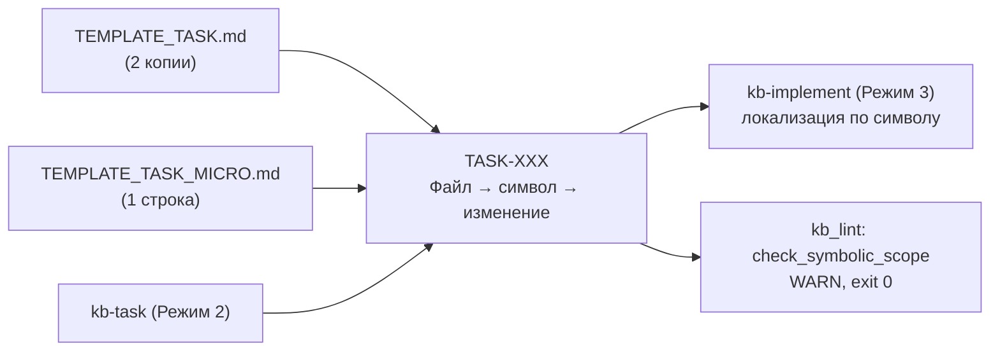

# 📋 План: PLAN-024 — Фаза 25: Символьные контракты скоупа задач (Symbolic Scope)

> **ID:** PLAN-024 | **Статус:** Согласовано (2026-10-18)  
> **Фаза:** 25 | **Спецификация:** [[../../SPEC|SPEC.md]] | **Канбан:** [[../Kanban|Канбан]] | **Дорожная карта:** [[../Roadmap|Roadmap (Фаза 25)]]  
> **Нормативная база:** [[../../04_Research/RESEARCH-024-fine-grained-task-scope-and-symbol-contracts|RESEARCH-024]], [[../../03_Decisions_ADR/ADR-0029-fine-grained-task-symbol-contracts-and-line-drift-rejection|ADR-0029]]  
> **Источник:** пункт Icebox «Символьные контракты скоупа задач» — единственный `🔬` по Evidence Status

---

## 1. Контекст и цели (Problem & Goals)

### 1.1. Проблема: спецификация, которая не локализует код

Секция 2 задачи сегодня — плоский список из трёх строк:

```markdown
* `[NEW]` `path/file.ext` — назначение
* `[MODIFY]` `path/file.ext` — суть изменений
* `[DELETE]` `path/file.ext` — причина
```

Агент в Режиме 3 знает **файл**, но не знает **границу вмешательства** внутри файла. Дальше два плохих сценария: переписать файл целиком «по смыслу» или угадывать участок по номерам строк. Номера строк нестабильны (любой промежуточный коммит смещает позиции), а инструменты патчинга работают по совпадению текста или AST-символам, не по абсолютным координатам.

Решение уже принято — [[../../03_Decisions_ADR/ADR-0029-fine-grained-task-symbol-contracts-and-line-drift-rejection|ADR-0029]] (2026-10-17): иерархический контракт «Файл → символ/метод → изменение» и запрет фиксации строк. Но в шаблонах оно не реализовано, а `TEMPLATE_TASK_MICRO.md` до сих пор подсказывает «конкретная функция, **строка** или блок» — то есть шаблон обучает ровно тому, что запрещает ADR. Это не новый функционал, а **лаг между принятым решением и артефактом**.

### 1.2. Аудит перед планированием (2026-10-18)

| Проверка | Факт | Следствие |
| :--- | :--- | :--- |
| `docs/00_Templates/TEMPLATE_TASK.md` §2 | 3 плоские строки, 2 625 B | Границы символов не заданы |
| `TEMPLATE_TASK_MICRO.md` §2 | подсказка «функция, строка или блок», 1 614 B | Прямое противоречие ADR-0029 |
| `templates/` ↔ `docs/00_Templates/` | Tier 1 parity-тест (TASK-092) | Правка в обе копии, тест защищает |
| `scripts/kb_lint.py` | `check_fast_track_specs` уже парсит §2; проверки символов нет | Новая advisory-проверка встраивается в существующий разбор |
| Бюджеты High-SNR | шаблоны 29 579 / 30 000; скиллы 30 654 / 31 000; `install.py` 173 887 / 175 000 | Изменение должно быть компактным |
| `ADR-0029` | `status: accepted`, отдельной фазы нет | «Принято» не значит «запланировано» |
| Исторические спеки | `status: done` | Проверка должна быть forward-only |

### 1.3. Что именно означает `🔬`

В [[../../04_Research/RESEARCH-024-fine-grained-task-scope-and-symbol-contracts|RESEARCH-024]] §3 «Практические замеры» — это закомментированный псевдокод с утверждениями «100% сбой / 100% успех», без команд, окружения и серии прогонов. По [[../../03_Decisions_ADR/ADR-0009-high-snr-token-architecture-and-context-efficiency|ADR-0009]] и правилу Benchmark Persistence это не замер.

`🔬` здесь означает **дизайн-валидировано**, а не **эмпирически доказано**. План принимает это честно: после раскатки собираем полевые данные на трёх следующих задачах (§6) и не заявляем заранее, что число ошибок снизится.

### 1.4. Цель фазы и метрики успеха

* `TEMPLATE_TASK.md` содержит иерархический контракт, `TEMPLATE_TASK_MICRO.md` — компактную символьную подсказку без слова «строка».
* Обе копии шаблонов побайтово совпадают (существующий parity-тест зелёный).
* `/kb-task` требует символьный скоуп, `/kb-implement` локализует по символу, а не по номеру строки.
* `kb_lint.py`: новая задача (`planned` / `in-progress`) с кодовым `[MODIFY]`/`[NEW]` без вложенного символа даёт `WARN:` при Exit code 0; маркеры `file.py:L10-L20` дают отдельный `WARN:`; `done`-спеки и fast-track молчат.
* Спеки самой Фазы 25 оформлены в новом формате (dogfooding) — линтер не выдаёт предупреждений на собственный проект.
* Свежая установка содержит новый шаблон, `--update` обновляет его, бюджеты не превышены.

---

## 2. Обсуждение и решения (Q&A)

* **Q1: Какой формат контракта?**
  * **Решение:** иерархия «Файл → символ → изменение» строго в `TASK-XXX` (Режим 2):
    ```markdown
    * `[MODIFY]` `scripts/kb_lint.py`:
      - `check_symbolic_scope(docs_dir)`: новая advisory-проверка.
      - `run_linter()`: вызов и агрегация `WARN`.
    * `[NEW]` `tests/test_kb_lint.py`:
      - `test_missing_symbol_warns()`: контракт поведения.
    * `[DELETE]` `scripts/legacy_scope.py` — причина удаления.
    <!-- Только символы, без номеров строк (ADR-0029) -->
    ```
  * **Границы:** `[DELETE]` — без символов; не-кодовые файлы (`.md`, `.yml`, `.json`, `.toml`) — без символов; для `[NEW]` кода указывается контракт нового символа.
  * **Отклонено:** оставить плоский список (не локализует), номера строк (ADR-0029), символы в `PLAN-XXX` (нарушает уровни абстракции).

* **Q2: Что с Fast-Track?**
  * **Решение:** в `TEMPLATE_TASK_MICRO.md` одна строка: `— символ(ы): Class.method(); без номеров строк`. Иерархия не вводится.
  * **Отклонено:** полная иерархия в micro — Fast-Track потеряет своё единственное преимущество (скорость).

* **Q3: Насколько жёсткой должна быть проверка?**
  * **Решение:** неблокирующий `check_symbolic_scope(docs_dir)`. Фильтры: `type: task`, `status` ∈ {`planned`, `in-progress`}, только кодовые расширения и только `[MODIFY]`/`[NEW]`. Нет вложенного символа → `WARN:`; маркеры `:L10-L20` / `L10-L20` → отдельный `WARN:`. Оба агрегируются как неблокирующие (прецеденты `check_research_basis`, `check_memory_consistency`), Exit code остаётся 0.
  * **Отклонено:** блокирующий `ERROR` (десятки исторических `done`-спек и легаси-задачи клиентов), проверка всех статусов (шум и привыкание к предупреждениям).

* **Q4: Как уложиться в бюджеты?**
  * **Решение:** бюджетно-нейтральная формулировка. Целевой прирост: шаблоны `≤ +250 B` (≤ 29 829), скиллы `≤ +150 B` (≤ 30 804), `install.py` `≤ +300 B` (≤ 174 187). Если не влезаем — сжимаем соседний текст в тех же файлах.
  * **Отклонено:** сразу поднять лимиты (маскирует рост и обесценивает ADR-0009); сокращать Visual DoD или 4-State Matrix (полезные разделы, не связанные с целью).

* **Q5: Добавлять ли Tier 2-строку в `rules/AGENTS_CORE.md`?**
  * **Решение:** нет. Шаблон — durable-артефакт, скилл — процедура Режима 2, lint — Tier 1 (advisory). Этого достаточно; правка корпуса повлекла бы регенерацию `AGENTS.md` и 12 golden-фикстур, не добавляя механической гарантии.
  * **Отклонено:** новый блок `<!-- RULE: SYMBOLIC-SCOPE -->` — дублирует требование и ломает пины инвентаря.

* **Q6: Как не сломать обратную совместимость и не получить самопредупреждения?**
  * **Решение:** проверка forward-only по статусу; `done`-спеки не переписываются; спеки Фазы 25 сразу оформляются в новом формате; `install.py --update` обновляет шаблоны и скиллы, но не пользовательские ТЗ (проверяется E2E).
  * **Отклонено:** авто-миграция старых ТЗ (переписывание истории и потеря исходного контекста).

* **Q7: Можно ли механически проверять имена символов?**
  * **Решение:** нет. Zero-Deps (ADR-0001) и пять стеков исключают AST-парсер в линтере. Проверяется форма контракта и отсутствие номеров строк; семантика — на агенте (grep/AST в Режиме 3). Шаблон защищён Tier 1 source-guard тестом, эффект измеряется пилотом (§6).
  * **Отклонено:** тянуть `LibCST` / `ts-morph` / Roslyn — нарушение Zero-Deps и рост дистрибутива.

* **Q8: Что делать с устаревшим Icebox в `Kanban.md`?**
  * **Решение:** зафиксировать `DEBT-003` (P3) и не исправлять в этой фазе (Single-Task Barrier); чистка — отдельной микро-задачей.

### 2.1. Research Basis & Unvalidated Assumptions

* **Известно (проверено инспекцией кода 2026-10-18):** текущий текст §2 обеих копий `TEMPLATE_TASK.md` и `TEMPLATE_TASK_MICRO.md`; наличие parity-теста; устройство `check_fast_track_specs` и прецеденты неблокирующих `WARN:`; точные бюджеты шаблонов, скиллов и монолита; статус ADR-0029 и отсутствие фазы; `status: done` у исторических спек.
* **Не проверено (гипотезы):**
  * **H1:** агент устойчиво локализует символ по имени и не расширяет скоуп → пилот на трёх задачах (§6): уточнения по скоупу и правки вне символов.
  * **H2:** advisory-проверка не создаёт шума у клиентов → сухой прогон на репозитории и E2E свежей установки (TASK-096).
  * **H3:** контракт влезает в бюджет без потери читаемости → бюджетные ассерты `test_16` после пересборки (TASK-096).
  * **H4:** символьные ориентиры работают во всех пяти стеках → формулировка в скиллах нейтральна к языку; проверка на задачах Фазы 25.
* **Как закрываем:** H1 — пилот; H2/H3 — dry-run и Tier 1 бюджетные тесты; H4 — dogfooding и наблюдаемость в Devlog.
* **Обратимость:** изменения текстовые (шаблоны, скиллы, одна проверка линтера), внешних зависимостей и публичных API не добавляют; откат — возврат файлов из истории. Полный Режим 0 не требуется: RESEARCH-024 и ADR-0029 уже существуют, их ограничение честно зафиксировано в §1.3.

---

## 3. Архитектурное влияние и риски

### Затрагиваемые компоненты

`docs/00_Templates/TEMPLATE_TASK.md`, `templates/TEMPLATE_TASK.md`, `docs/00_Templates/TEMPLATE_TASK_MICRO.md`, `templates/TEMPLATE_TASK_MICRO.md`, `.agents/skills/kb-task/SKILL.md`, `.agents/skills/kb-implement/SKILL.md`, `scripts/kb_lint.py`, `tests/test_kb_lint.py`, `tests/test_installer.py`, `install.py` + `dist/install.py` (пересборка), `SPEC.md`, `README.md`, `docs/Onboarding.md`.

### Поток данных



### Prior-Art Gate

* **Внутренний аудит:** секция `## 3. Детали реализации` уже содержит сигнатуры — новый контракт не дублирует её, а связывает файл с символом; `check_fast_track_specs` уже разбирает §2, поэтому новая проверка переиспользует разметку; advisory-паттерн `WARN:` отработан в `check_research_basis` и `check_memory_consistency`; parity-тест и source-guard тест (TASK-090) уже существуют; `--update` умеет обновлять шаблоны, не трогая пользовательские заметки.
* **Внешний аудит:** формат близок к практике ADR и «files changed» в code review; AST-инструменты (`LibCST`, `ts-morph`, SwiftSyntax, Roslyn) решают задачу точнее, но требуют зависимостей и отдельного парсера на каждый стек — отклонено по ADR-0001. Готового кросс-языкового zero-deps формата не существует, поэтому фиксируем Markdown-конвенцию.
* **Почему пишем своё:** конвенция не требует кода вообще; линтер добавляет только проверку формы на stdlib (`re`, `pathlib`).

### Риски и митигация

| Риск | Влияние | Митигация |
| :--- | :--- | :--- |
| Выход за бюджеты шаблонов/скиллов | Среднее | Компактный пример; цели `+250/+150/+300 B`; бюджетные тесты в TASK-096 |
| Шум `WARN` в клиентских проектах | Среднее | Фильтр по статусу, кодовым расширениям и типу; старт только advisory |
| Самопредупреждения на спеках Фазы 25 | Среднее | Dogfooding: спеки сразу в новом формате (Q6) |
| Регресс парсера Fast-Track | Среднее | Вложенные строки не начинаются с маркера; отдельный тест на счётчик файлов |
| Остаточная зависимость от Tier 3 | Высокое | Source-guard тест шаблона + advisory-lint + пилот; ограничение задокументировано в §1.3/§2 |
| `--update` затирает пользовательские ТЗ | Высокое | Существующий механизм обновляет только шаблоны/скиллы; E2E в TASK-096 |
| Символы «протекают» в `PLAN-XXX` | Среднее | Явный non-goal; ADR-0029 §2.3 сохраняет макро-уровень плана |

### The 4-State UI Matrix

Не применимо: фаза меняет Markdown-шаблоны и вывод линтера, GUI/TUI отсутствует. Пользовательские поверхности — текст шаблона в редакторе и строка `WARN:` в CLI; состояний Empty/Loading/Error/Populated у них нет. Артефакты `docs/assets/mockups/` не требуются.

### Отвергнутые альтернативы

* **Номера строк** — отклонено ADR-0029 (Line Drift).
* **Символы в `PLAN-XXX`** — отклонено ADR-0029 (Leaky Abstraction).
* **Блокирующий линтер** — шум и ложные отказы на исторических/клиентских задачах.
* **AST-извлечение символов в линтере** — Zero-Deps и пять стеков.
* **Отдельный YAML/JSON-контракт** — второй источник правды, лишний формат и тулинг.
* **Новый файл шаблона** — 16 шаблонов уже на бюджете; расширяем существующий.
* **Tier 2-строка в корпусе правил** — churn golden-фикстур без механического выигрыша.
* **Авто-миграция старых ТЗ** — переписывание истории.

---

## 4. Декомпозиция задач (Task Breakdown)

Задачи фазы ставятся в Режиме 2 и **сразу оформляются в новом формате** (dogfooding, Q6).

* [ ] `TASK-094` — **Шаблоны и source-guard**: иерархический контракт в `docs/00_Templates/TEMPLATE_TASK.md` и `templates/TEMPLATE_TASK.md`; символьная подсказка вместо «строка или блок» в обеих копиях `TEMPLATE_TASK_MICRO.md`; Tier 1 source-guard тест в `tests/test_installer.py` (читает файл-источник, а не снимок бандла); замер бюджетов (≤ +250 B).
* [ ] `TASK-095` — **Поведение и advisory-lint**: одна фраза в `.agents/skills/kb-task/SKILL.md` (символьный скоуп в §2) и в `.agents/skills/kb-implement/SKILL.md` (локализация по символу, не по строке); `check_symbolic_scope()` в `scripts/kb_lint.py` с фильтрами Q3 и интеграцией в verbose/silent-ветки; 6 тестов в `tests/test_kb_lint.py` (символ есть/нет, `done` молчит, fast-track молчит, конфиг молчит, line-number `WARN`).
* [ ] `TASK-096` — **Bundle, E2E и Living Spec**: пересборка `install.py` / `dist/install.py` через `scripts/build_installer.py`; E2E в `tests/test_installer.py` (свежая установка содержит контракт; `--update` обновляет старый шаблон, не трогая пользовательские ТЗ); бюджетные ассерты; Living Spec Sync (`SPEC.md` §2.3/§2.4, `README.md`, `docs/Onboarding.md`); полный прогон `unittest` и `kb_lint`.

---

## 5. Критерии приемки плана (DoD Режима 1)

- [x] Концепция согласована с пользователем (READ-ONLY, без кода) — подтверждено 2026-10-18: advisory-линтер, бюджеты сжимаем, Tier 2 не трогаем.
- [x] Дорожная карта `Roadmap.md` обновлена (Фаза 25 открыта, пункт Icebox промоутирован).
- [x] Карточка добавлена в `Kanban.md` в `📥 Бэклог`.
- [x] Целостность подтверждена через `scripts/kb_lint.py` (240 файлов, 2321 ссылка, 0 битых).

---

## 6. Пострелизная валидация (пилот)

Пилот не доказывает превосходство (базовой линии нет) — он собирает данные, чтобы не оставить `🔬` на уровне дизайн-обоснования.

* **Выборка:** три следующих задачи после Фазы 25 (в Режиме 2 и 3).
* **Метрики:** (1) число уточняющих вопросов по скоупу в Режиме 3; (2) число правок вне объявленных символов, пойманных на ревью; (3) число `WARN` от `check_symbolic_scope` на новых спеках (цель — 0).
* **Фиксация:** запись в `docs/Devlog.md` по каждой задаче; итог — после третьей.
* **Решение:** оставить контракт как есть / ужесточить формулировку / откатить wording. Решение принимается по данным, а не по инерции.
