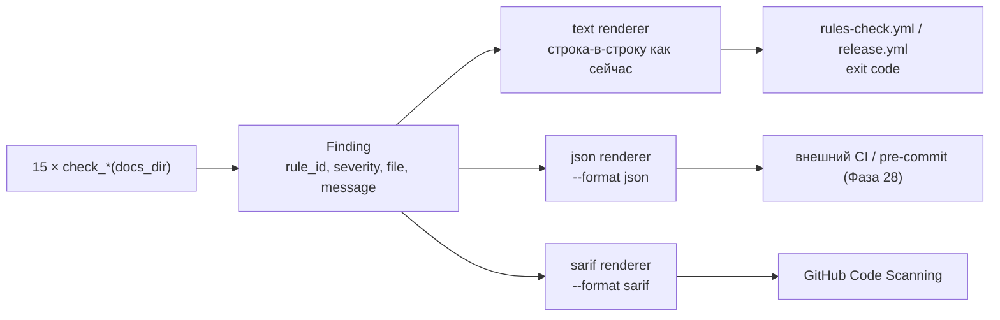

# 📋 План: PLAN-025 — Фаза 27: Продуктизация линтера (Docs Integrity Gate, P0)

> **ID:** PLAN-025 | **Статус:** Согласовано (2026-10-25)  
> **Фаза:** 27 | **Спецификация:** [[../../SPEC|SPEC.md]] | **Канбан:** [[../Kanban|Канбан]] | **Дорожная карта:** [[../Roadmap|Roadmap (Фаза 27)]]  
> **Нормативная база:** [[../../04_Research/RESEARCH-027-competitor-best-practices-and-adoption-backlog|RESEARCH-027]] (§4 Волна 1 п.1, §5.1); ADR-0032 (оформляется в рамках TASK-101)  
> **Источник:** пункт Icebox «Продуктизация `kb_lint`» — `🔬` по Evidence Status (deep-dive с контрактом, DoD и рисками в RESEARCH-027 §5.1)  
> **Связанный техдолг:** `DEBT-004` (SARIF без `region.startLine`), регистрируется в [[../TechDebt|TechDebt.md]] этим планом

---

## 1. Контекст и цели (Problem & Goals)

### 1.1. Проблема: линт, который нельзя встроить

`scripts/kb_lint.py` — единственный Tier 1-гейт базы знаний, но наружу он отдаёт **только человекочитаемый текст и код возврата**. Из этого следуют три ограничения:

1. **CI и code scanning.** GitHub Code Scanning, SARIF-приёмники и любые агрегаторы диагностики работают с машинными форматами. Сейчас единственный машинный сигнал — exit code: «что-то не так», без файла, правила и категории.
2. **Эволюция правил.** Любая новая проверка (`KB-010` для `depends_on`, предупреждение right-sizing, spec quality gate) — это новое правило. Без реестра стабильных ID каждое правило живёт только в тексте, и внешние конфиги (ignore-листы, severity-политики, pre-commit) привязать не к чему.
3. **Продукт vs внутренний скрипт.** RESEARCH-027 §7.3 фиксирует: wedge харнесса — «доказуемость», а не автономия. Доказуемость начинается с того, что проверки отдают структуру, а не строки.

Это фаза-фундамент: она не добавляет ни одной новой проверки поведения, она меняет **контракт вывода** и **реестр правил**, на который опираются все последующие фазы.

### 1.2. Аудит перед планированием (2026-10-25)

| Проверка | Факт | Следствие |
| :--- | :--- | :--- |
| `scripts/kb_lint.py` | 1 291 строка, **74** вызова `print()`, 15 `check_*`-функций возвращают **готовые строки** (часть с префиксами `WARN:`, часть без) | JSON/SARIF невозможны «добавлением флага»: нужна единая модель находки и рендереры |
| CLI | только `--path/-p` и `--verbose/-v` | Новые флаги не конфликтуют с существующими |
| `tests/test_kb_lint.py` | **60** тестов, ассертят точный текст (`"✅ No broken wikilinks found!"`, `"OK: … 0 broken"`, `"⚠️  WARN: …"`) | Text-вывод — часть контракта; 60 тестов = готовая регрессионная сеть паритета |
| `install.py` | 175 175 B при бюджете **176 000** B (`test_16`) → запас **825 B** | Прирост рендереров не влезает в запас → нужен явный ре-базлайн (Q4) |
| Коэффициент бандла | `kb_lint.py` = 51 329 символов → zlib-9 + base64 ≈ **3.13 символа исходника на 1 байт** `install.py` | +3 500 символов кода ≈ +1 100 B монолита |
| CI | `rules-check.yml` и `release.yml` вызывают `python scripts/kb_lint.py --path docs` (text) | Text обязан остаться дефолтом и не измениться |
| Реестр `KB-XXX` | В коде отсутствует; нумерация зафиксирована только в RESEARCH-027 §5.1 | ID нужно закрепить в коде как SSOT до появления `KB-010` |
| Версии-SSOT | Нет `pyproject.toml` / `VERSION`; `kb_release.py --version <tag>` получает тег извне | «Релизную версию» в `--version` показывать нечем (Q5) |
| TechDebt | `Active P3 Debt` пуст | Регистрируем `DEBT-004` в этой фазе |
| Бюджеты High-SNR | шаблоны/скиллы не затрагиваются | Токен-бюджеты ADR-0009 остаются нетронутыми |

### 1.3. Честная трактовка `🔬`

RESEARCH-027 §5.1 — это **дизайн-контракт, а не замер**: предложены `--format`, набор полей, примерный SARIF и DoD, но никто не проверял, что минимальный SARIF примет GitHub Code Scanning, и не измерялся объём рефактора. `🔬` здесь означает «дизайн проработан и оценён», а не «эмпирически доказано». Отдельного ADR пока нет — решение фиксируется в ADR-0032 внутри TASK-101, как это было с ADR-0030 в Фазе 22.

### 1.4. Цель фазы и метрики успеха

* Единая модель находки (`Finding`) — **единственная** форма результата всех проверок; text-рендерер строится из неё и воспроизводит текущий вывод **побайтово** (60 существующих тестов зелёные без правки ассертов).
* Реестр правил `KB-001…KB-015` закреплён в коде: ID, severity, описание; `KB-010` зарезервирован под `depends_on` и **не эмитится**.
* `--format {text,json,sarif}`: `json` парсится `json.loads` и содержит `version`/`summary`/`errors`/`warnings`; `sarif` — один валидный по структуре документ 2.1.0, каждый `ruleId` присутствует в `runs[0].tool.driver.rules[]`.
* `--version` печатает версию набора правил (`kb_lint 1`), не имитируя релизную версию (Q5).
* Инварианты не сломаны: exit-коды `0/1` одинаковы для всех форматов; `--format`≠text не печатает ни эмодзи, ни `OK:`-строку; набор находок на самом репозитории **не меняется** (семантический паритет, не только текстовый).
* `install.py` ≤ 178 000 B, `dist/install.py` синхронен; установленная копия `scripts/kb_lint.py --format json` работает в песочнице.
* Living Spec: `SPEC.md` (CLI-контракт), `README.md`, `docs/Onboarding.md` обновлены.

---

## 2. Обсуждение и решения (Q&A)

* **Q1: Как вводить модель находки — точечно или целиком?**
  * **Решение:** целиком, в одной задаче. `Finding` (`rule_id`, `severity`, `file`, `message`) становится **единственной** формой результата: все 15 `check_*` перестают возвращать предформатированные строки, а `text`-рендерер собирает текущие строки из находок. Паритет доказывается существующими 60 тестами.
  * **Отклонено:** парсинг готовых строк регулярками (хрупко: сообщения содержат пути, кавычки и эмодзи); гибрид «старые проверки — строки, новые — находки» (две параллельные абстракции одного понятия — прямое нарушение Prior-Art Gate и правило 14 `AGENTS.md`); отдельный `kb_lint_json.py` (дублирование проверок в бандле).
  * **Цена:** большой дифф одного файла; поэтому фаза разбита так, что рефактор и рендереры — одна задача (TASK-101), а контрактные тесты — следующая (TASK-102).

* **Q2: Схема JSON и набор полей?**
  * **Решение:** `{"version": 1, "summary": {"files", "wikilinks", "errors", "warnings"}, "errors": [...], "warnings": [...]}`; элемент — `{"rule_id", "severity", "file", "message"}`. `version` — версия **схемы**, не релиза.
  * **Отклонено:** включать `line` и `fixable` сейчас (Q2а).
  * **Q2а (почему без `line`/`fixable`):** `fixable` имеет смысл только с `--fix` (вне scope); `line` никем не вычисляется и был бы всегда `null` — ложное обещание точности. Оба поля появятся вместе с их реализацией; добавление поля в JSON обратно совместимо, поэтому ждать нечего.
  * **Отклонено:** SARIF-стиль сразу в JSON (SARIF — отдельный формат, не надо смешивать); вложенность по проверкам вместо `errors/warnings` (усложняет потребителя, ломает сортировку по severity).

* **Q3: SARIF — насколько глубоко?**
  * **Решение:** SARIF 2.1.0, минимально достаточный: `$schema`, `version`, `runs[0].tool.driver{name, informationUri, rules[{id, shortDescription}]}`, `runs[0].results[{ruleId, level, message.text, locations[{physicalLocation.artifactLocation.uri}]}]`; `level` = `error`/`warning` из severity.
  * **Без `region.startLine`:** линтер не считает номера строк, а фальшивая строка 1 хуже её отсутствия. Зафиксировано как `DEBT-004` (P3) — аннотации в Code Scanning будут на файл, а не на строку.
  * **Валидация:** Zero-Deps запрещает `jsonschema` ([[../../03_Decisions_ADR/ADR-0001-zero-dependencies-python-stdlib|ADR-0001]]), поэтому проверяются инварианты структуры и перекрёстные ссылки `ruleId → rules[]`; приёмка GitHub-ом проверяется вручную в TASK-102 и фиксируется в Devlog. **Не заявляем в DoD «SARIF валиден по схеме».**
  * **Отклонено:** тянуть `jsonschema` (ADR-0001); отдавать SARIF с `region: {startLine: 1}` (ложная точность); вообще не делать SARIF (тогда теряется главный сценарий — Code Scanning).

* **Q4: Что делать с бюджетом `install.py` (запас 825 B)?**
  * **Решение:** явный ре-базлайн **176 000 → 178 000 B** в `test_16` с комментарием, объясняющим причину. Прецедент существует: комментарий теста перечисляет фазы, каждая из которых двигала бюджет; 825 B не покрывают даже половину оценки диффа (≈ +1 100 B).
  * **Почему не «влезть в 825 B»:** зажатый код (сокращение рендереров в ущерб читаемости) плюс нулевой запас на ошибку оценки. Компрессия непредсказуема: погрешность ±30 % на таком диффе больше самого запаса.
  * **Почему не «отдельный модуль-скрипт»:** он всё равно уедет в бандл (и станет четвёртым файлом в `build_installer.py`), но добавит дублирование и точку рассинхрона.
  * **Границы:** бюджет High-SNR для шаблонов (30 000) и скиллов (31 000) **не трогаем** — фаза их не меняет. Бюджет монолита — про вес дистрибутива, а не про токены контекста.

* **Q5: Что печатает `--version` при отсутствии версии-SSOT?**
  * **Решение:** `kb_lint 1` — версия набора правил/схемы. Это честно и не дрейфует.
  * **Отклонено:** хардкод релизной версии (разъедется с тегом на первом же релизе); вводить `VERSION`/`pyproject.toml` в этой фазе (новый SSOT тянет за собой релизный конвейер, `--report` и `doctor`).
  * **Куда уходит потребность:** Icebox-пункт `[P2] doctor и upgrade diff` — там и появится версия инсталляции.

* **Q6: Как `--format` сосуществует с `--verbose` и silent-on-success?**
  * **Решение:** `--format text` (дефолт) — поведение не меняется вообще. `--format json|sarif` печатает **только** машинный документ: эмодзи, `OK:`-строка и `--verbose`-блоки подавляются, `--verbose` в этом режиме — задокументированный no-op. Exit-коды не меняются.
  * **Отклонено:** ошибка парсера при `--format json --verbose` (сломает generic CI-обёртки, передающие `-v` всегда).

* **Q7: Что явно **не** входит?**
  * **Не входит:** `--fix` (автоправка ссылок — отдельная фаза с `--dry-run` по умолчанию и backup), `action.yml`, `.pre-commit-hooks.yaml`, `kb_state.py`, `depends_on`/`KB-010`, right-sizing-предупреждение, правки скиллов. Icebox-пункт сохраняет остаток (см. `Roadmap.md`).
  * **Почему:** «ни один новый гейт не добавляется без трека, который его пропускает» (RESEARCH-027 §7.1) — и ни один формат не добавляется раньше контракта, который он сериализует.

* **Q8: Реестр ID — как нумеруем?**
  * **Решение:** `KB-001…KB-010` берём **как в RESEARCH-027 §5.1 без перенумерации** (уже опубликованы в Roadmap: `KB-010` для `depends_on`); существующие проверки вне этого списка получают `KB-011…KB-015`. `KB-010` регистрируется в реестре со статусом «зарезервирован», но ни один `check_*` его не эмитит — иначе Roadmap и линт начнут расходиться.
  * **Отклонено:** перенумеровать «по логике проверок» (ломает уже опубликованные ссылки); не резервировать `KB-010` (следующая фаза молча займёт чужой номер).

### 2.1. Research Basis & Unvalidated Assumptions

* **Известно (проверено инспекцией кода и прогонами 2026-10-25):** устройство `run_linter` и всех 15 проверок; 74 точки `print()`; 60 тестов с текстовыми ассертами; CLI-поверхность (`--path`, `--verbose`); запас бюджета 825 B и коэффициент бандла 3.13; вызовы линта в `rules-check.yml` и `release.yml`; отсутствие реестра `KB-XXX` и версии-SSOT; пустой `Active P3 Debt`; baseline `251 файл / 2459 ссылок / 0 битых`.
* **Не проверено (гипотезы):**
  * **H1:** машинный формат кому-то нужен до появления CI-упаковки → замер: adoption `--format` после Фазы 28 (счётчик обращений в README/issue не механизируется, поэтому H1 остаётся гипотезой и не влияет на DoD).
  * **H2:** минимальный SARIF принимается GitHub Code Scanning → ручная проверка в TASK-102.
  * **H3:** прирост монолита ≤ 2 825 B → замер `stat()` после пересборки (детерминированно, не бенчмарк).
  * **H4:** полный рефактор 15 проверок не меняет их семантику → сравнение набора находок «до/после» на реальном репозитории (0 расхождений) + 60 тестов.
* **Как закрываем:** H2 — TASK-102; H3 — бюджетный ассерт TASK-103; H4 — паритетный прогон TASK-101/103; H1 — пострелизное наблюдение (§6), на объём работ не влияет.
* **Обратимость:** изменения локальны (`scripts/kb_lint.py`, `tests/`, бюджет `test_16`, документация). Публичных API и внешних зависимостей нет; откат — возврат файлов из истории. Режим 0 не требуется: RESEARCH-027 уже содержит deep-dive, ограничение честно зафиксировано в §1.3.

---

## 3. Архитектурное влияние и риски

### Затрагиваемые компоненты

`scripts/kb_lint.py`, `tests/test_kb_lint.py`, `tests/test_installer.py` (бюджет `test_16` + E2E установленной копии), `install.py` / `dist/install.py` (пересборка бандла), `SPEC.md`, `README.md`, `docs/Onboarding.md`, `docs/02_Tasks/TechDebt.md` (`DEBT-004`), новый `docs/03_Decisions_ADR/ADR-0032-*` (в TASK-101).

### Поток данных

### Prior-Art Gate

* **Внутренний аудит:** `kb_release.py` уже сериализует JSON (`json.dumps(..., indent=2, ensure_ascii=False)`) — стиль переиспользуем, не изобретаем; `.inbox_state.json` использует `{"version": 1, …}` — та же конвенция версии схемы; `check_*`-паттерн и `test_16` уже существуют; `install.py --report` уже отдаёт диагностику, но текстом — эту фазу он не затрагивает.
* **Внешний аудит:** SARIF 2.1.0 (OASIS) и GitHub Code Scanning — стандарт де-факто для code scanning; `ruff`/`eslint`/`clang-tidy` используют ровно связку «rule id + json + sarif», что подтверждает форму контракта. Готового zero-deps линтера с нашим набором проверок (wikilinks, frontmatter, память, техдолг, фазы, ассеты) не существует.
* **Почему пишем своё:** проверки предметно-специфичны; интегрировать их в чужой линтер невозможно, а внешние зависимости запрещены [[../../03_Decisions_ADR/ADR-0001-zero-dependencies-python-stdlib|ADR-0001]].

### Риски и митигация

| Риск | Влияние | Митигация |
| :--- | :--- | :--- |
| Ломается text-вывод (60 тестов) | Высокое | Рендерер воспроизводит строки 1:1; ни один ассерт не правится; паритетный прогон на реальном репозитории |
| Рефактор меняет семантику проверок | Высокое | Одна задача = один файл; сравнение набора находок «до/после» (0 расхождений) |
| Прирост монолита больше запаса | Среднее | Ре-базлайн до 178 000 с комментарием; ассерт `test_16` после пересборки |
| SARIF не принимается Code Scanning | Среднее | Ручная проверка в TASK-102; при отказе — фиксируем в Devlog и корректируем контракт, не выдумывая валидность |
| `--format` протекает в stdout (эмодзи, `OK:`) | Среднее | Тест: весь stdout парсится одним `json.loads`; для SARIF — ровно один JSON-документ |
| Клиентские проекты ломаются на новом дефолте | Низкое | Дефолт — `text`, неизменный; E2E установленной копии |
| Нумерация `KB-XXX` разъедется с Roadmap | Низкое | Реестр в коде — SSOT; `KB-010` зарезервирован; тест на отсутствие эмиссии |
| Оценка объёма занижена (S → M) | Среднее | Фаза разбита на 3 задачи; рефактор и рендереры — отдельно от упаковки |

### The 4-State UI Matrix (терминальный вывод линта)

| Состояние | Поведение и визуализация | Обработка краевых случаев |
| :--- | :--- | :--- |
| **Empty** | Находок нет: `OK: N files scanned, M wikilinks verified (0 broken).`; `json` — пустые `errors`/`warnings`; `sarif` — `results: []` | Пустая база знаний / 0 ссылок: счётчики не делят на ноль, раздел не печатается |
| **Loading** | Не применимо: скан синхронный, один проход по файлам | Прогресс-бар не вводим — линт обязан быть тихим для CI |
| **Error** | Находки уровня `error`: `ERROR: … broken links, … frontmatter warnings, …` + маркированный список; exit 1 | Ошибки в `frontmatter`/памяти/техдолге агрегируются в одну сводку, а не печатаются по одной |
| **Populated** | Находки-предупреждения: `⚠️  WARN: …` по секциям; exit 0 | Дубли одного правила не схлопываются — важно видеть все вхождения |

Макеты не требуются: раскладка текста не меняется, меняется источник строк. Скриншот-слот для задачи — по правилу 12 `AGENTS.md` (в headless-окружении — ASCII-снимок вывода `--verbose` до/после в Devlog).

### Отвергнутые альтернативы

* **Парсинг готовых строк регулярками** — хрупко, ломается на путях с кавычками и эмодзи.
* **Гибрид «строки + находки»** — две параллельные абстракции; нарушает Prior-Art Gate.
* **Отдельный `kb_lint_json.py`** — дублирование проверок в бандле и рассинхрон.
* **`line`/`fixable` «на будущее»** — ложное обещание точности.
* **SARIF с фиктивной `startLine: 1`** — хуже отсутствия локации.
* **`jsonschema` для валидации SARIF** — нарушение ADR-0001.
* **Хардкод релизной версии в `--version`** — дрейф с тегом.
* **Интеграция `--fix` в эту фазу** — риск перезаписи пользовательских ссылок, отдельный дизайн.
* **Поднятие бюджетов шаблонов/скиллов** — фаза их не меняет, бюджет ADR-0009 трогать нельзя.

---

## 4. Декомпозиция задач (Task Breakdown)

* [ ] `TASK-101` — **Модель, реестр и форматы**: `Finding` + `LintReport`; реестр `KB-001…KB-015` (включая зарезервированный `KB-010`); миграция всех 15 `check_*` на находки; `text`/`json`/`sarif` рендереры; `--format` и `--version`; паритет на 60 существующих тестах; ADR-0032 о машинно-читаемом контракте.
* [ ] `TASK-102` — **Контрактные тесты**: `tests/test_kb_lint.py` — JSON-схема и стабильность ключей, SARIF-структура и перекрёстные `ruleId → rules[]`, уникальность/полнота реестра, неэмиссия `KB-010`, exit-коды для всех форматов, «`--format` печатает только документ», `--verbose` как no-op; ручная проверка SARIF в Code Scanning с записью результата.
* [ ] `TASK-103` — **Бандл, E2E и Living Spec**: пересборка `install.py` / `dist/install.py`; `test_16` бюджет 176 000 → 178 000 с комментарием; E2E установленной копии (`--format json` в песочнице, `--update`); `SPEC.md` (CLI-контракт и раздел о линтере), `README.md`, `docs/Onboarding.md`; `DEBT-004` в [[../TechDebt|TechDebt.md]]; полный прогон `unittest` и `kb_lint`.

---

## 5. Критерии приемки плана (DoD Режима 1)

- [x] Концепция согласована с пользователем (READ-ONLY, без кода) — подтверждено 2026-10-25: строгий scope (форматы + rule-id + `--version`), `--fix`/CI-упаковка/`kb_state` отложены.
- [x] Дорожная карта `Roadmap.md` обновлена (Фаза 27 открыта, Icebox-пункт промоутирован).
- [x] Карточка добавлена в `Kanban.md` в `📥 Бэклог`.
- [x] `DEBT-004` зарегистрирован в `TechDebt.md` (`Active P3 Debt`).
- [x] Целостность подтверждена через `scripts/kb_lint.py` (251 файл, 2459 ссылок, 0 битых до правок; повторный прогон — без новых `WARN`).

---

## 6. Пострелизная валидация

* **Время прогона:** `--format json` vs `text` на самом репозитории, ≥ 3 прогонов, первый (холодный) отбрасывается; расхождение > 20 % — повод оптимизировать рендеринг (Benchmark Persistence, правило 16 `AGENTS.md`).
* **Семантический паритет:** набор `(rule_id, file, message)` до и после рефактора на реальном репозитории совпадает (0 расхождений); расхождение = дефект, а не «улучшение».
* **Внешняя приёмка:** первый внешний потребитель `--format sarif` (CI-упаковка Фазы 28) — если формат придётся менять, это фиксируется как `BUG-XXX` с ломающим изменением контракта, а не тихо правится.
