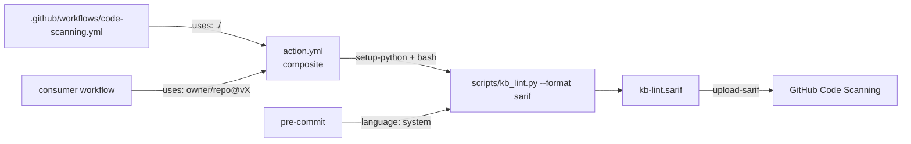

# 📋 План: PLAN-026 — Фаза 28 (продолжение): CI-доставка линта

> **ID:** PLAN-026 | **Статус:** Согласовано (2026-10-25)  
> **Фаза:** 28 | **Спецификация:** [[../../SPEC|SPEC.md]] | **Канбан:** [[../Kanban|Канбан]] | **Дорожная карта:** [[../Roadmap|Roadmap (Фаза 28)]]  
> **Нормативная база:** [[../../04_Research/RESEARCH-027-competitor-best-practices-and-adoption-backlog|RESEARCH-027]] (§4 Волна 1, п.1–2), [[../../03_Decisions_ADR/ADR-0032-machine-readable-lint-contract-and-rule-registry|ADR-0032]]  
> **Связанный техдолг:** `DEBT-004` (SARIF без `region.startLine`) — решение принимается в TASK-108

---

## 1. Контекст и цели (Problem & Goals)

Фаза 27 сделала линт машинно-читаемым, но доставила его только как файл в репозитории: у контракта `--format json/sarif` **нет потребителя**. Пока потребителя нет, `DEBT-004` (отсутствие номеров строк в SARIF) нельзя ни обоснованно закрыть, ни обоснованно чинить — это ровно тот случай, когда «точность впрок» и «удаление долга по интуиции» одинаково бесполезны.

Цель — замкнуть Волну 1 п.1–2 из RESEARCH-027: линт должен запускаться тремя способами, каждый из которых проверяется механически:

1. **GitHub Action** — `uses: koudinie101-png/agent-docs-harness@vX` без установки харнесса в проект.
2. **pre-commit hook** — локальный барьер до коммита.
3. **Code Scanning** — SARIF-алерты в собственной Security-панели, что одновременно закрывает «ручную приёмку SARIF», отложенную в TASK-102.

### 1.1. Аудит перед планированием (2026-10-25)

| Проверка | Факт | Следствие |
| :--- | :--- | :--- |
| Видимость репозитория | `PUBLIC` (`gh repo view`) | Code Scanning доступен бесплатно → приёмка SARIF выполнима |
| `rules-check.yml` | `permissions: contents: read`, push(all)+PR, 3 шага (rules, lint, tests) | Добавлять туда `security-events: write` нельзя — отдельный workflow с минимальными правами |
| `scripts/build_installer.py` | `EXCLUDED_WORKFLOWS = {"rules-check.yml"}`; остальные workflows уезжают клиентам | Новый SARIF-workflow обязан быть исключён, иначе у клиентов появится workflow с `security-events` и чужим контекстом |
| `action.yml` | Отсутствует; в бандл не входит (whitelist из 3 скриптов + assets) | Действие живёт только в репозитории-источнике — так и нужно |
| `scripts/kb_lint.py` | `--format {text,json,sarif}`, `--version`, exit-коды `0/1`; SARIF без `region` | Действию достаточно вызвать скрипт и вернуть его код |
| Проверка ссылок | Глобальная (`build_file_map` по всему vault) | Pre-commit не может линтить «по файлу» → `pass_filenames: false`, полный скан (~0.4 с) |
| `tests/test_ci_workflows.py` | Tier 1 guard по маркерам `rules-check.yml` | Туда же добавляются guard'ы нового workflow и исключения из бандла |
| `tests/test_installer.py::test_16` | installer budget 180 000 B | `action.yml`/хуки/workflow не бандлятся → бюджет не двигается |

## 2. Обсуждение и решения (Q&A)

* **Q1: Кто загружает SARIF — action или вызывающий workflow?**
  * **Решение:** action **только производит** файл (`sarif-file`, выход `sarif-file`), загрузку делает шаг потребителя (`github/codeql-action/upload-sarif`).
  * **Почему:** composite-действие не может выдать себе `security-events: write` — права объявляет только workflow вызывающего. Загрузка внутри action также привязала бы нас к мажорной версии `codeql-action` и сделала действие непроверяемым без Code Scanning.
  * **Отклонено:** встроенный `upload-sarif` «для удобства» (нарушает least privilege и тестируемость).

* **Q2: Python внутри action?**
  * **Решение:** `actions/setup-python@v5` внутри composite (`python-version` по умолчанию `3.11`) — как во всех существующих workflow репозитория.
  * **Отклонено:** системный `python3` (версия зависит от раннера; `ubuntu-24.04` и `windows` расходятся по путям и версиям).

* **Q3: Форма pre-commit-хука?**
  * **Решение:** `language: system`, `entry: python3 scripts/kb_lint.py --path docs`, `files: '\.md$'`, `pass_filenames: false`, `require_serial: true`. Документируются два рецепта: `repo: local` (после установки харнесса) и remote `repo:` + `rev:` (pre-commit запускает entry в cwd проекта-потребителя, где `scripts/kb_lint.py` уже есть).
  * **Почему `pass_filenames: false`:** проверка ссылок требует `file_map` по всему vault; поштучный режим дал бы ложные «битые ссылки» на файлы, не попавшие в выборку.
  * **Отклонено:** `language: python` с упаковкой пакета (`setup.py`/`pyproject`) — тянет публикацию в PyPI и ломает Zero-Deps простоту.

* **Q4: Как проверять SARIF в Code Scanning, не заводя зоопарк?**
  * **Решение:** один workflow `code-scanning.yml`, который потребляет **наш же** `action.yml` через `uses: ./`. Один прогон проверяет и действие, и SARIF-приёмку — без дублирующих шагов.
  * **Права:** `contents: read` + `security-events: write`; guard для fork-PR (`if: github.event_name != 'pull_request' || github.event.pull_request.head.repo.full_name == github.repository`), иначе загрузка падает на чужом PR.
  * **Отклонено:** отдельный workflow «для action» + второй «для SARIF» (дублирование и два места правки).

* **Q5: Что с `DEBT-004`?**
  * **Решение:** сначала проверка аннотаций в Code Scanning (TASK-107), затем **закрытие как принятого ограничения** (TASK-108): находки привязаны к файлу, а сообщение содержит имя ссылки/поля; трекинг строк потребовал бы переработки 15 проверок ради незначительного UX-выигрыша. Если Code Scanning покажет, что файла недостаточно, заводится отдельная задача на строки для `KB-001`/`KB-006`/`KB-014` — **не** в этой фазе.
  * **Отклонено:** реализовывать строки «на всякий случай» до появления потребителя (ровно та ошибка, из-за которой долг и откладывался).

* **Q6: Как не сломать клиентов?**
  * **Решение:** `code-scanning.yml` добавляется в `EXCLUDED_WORKFLOWS`; Tier 1-тест проверяет, что harness-only workflows отсутствуют в бандле (через `bundle_assets()` с перехватом stdout). `rules-check.yml` права не меняет.
  * **Отклонено:** отдавать клиентам workflow с `security-events: write` «на будущее» — у них нет ни Code Scanning, ни нашего SARIF-контура.

### 2.1. Research Basis & Unvalidated Assumptions

* **Известно (проверено 2026-10-25):** видимость репозитория `PUBLIC`; состав и права трёх существующих workflows; `EXCLUDED_WORKFLOWS` и механика бандла; CLI-контракт `kb_lint` (`--format`, `--version`, exit-коды); глобальность проверки ссылок; наличие `tests/test_ci_workflows.py`; бюджет `test_16` = 180 000 B.
* **Не проверено (гипотезы):**
  * **H1:** Code Scanning примет наш минимальный SARIF (без `region`, без `informationUri`) → проверка TASK-107 (алерт в Security).
  * **H2:** composite-действие корректно резолвит `github.action_path` в `uses: ./` → smoke в том же workflow.
  * **H3:** pre-commit-хук с `language: system` работает из remote `rev:` в проекте-потребителе → ручная проверка на песочнице (установка + `pre-commit run --all-files`), E2E-тест не автоматизируется (внешний инструмент, `pre-commit` не входит в зависимости).
  * **H4:** annotations file-level достаточно → решение по `DEBT-004` в TASK-108 по фактическому скриншоту Security-панели.
* **Как закрываем:** H1/H2 — TASK-107 (лог workflow + скриншот алерта в Devlog); H3 — ручная песочница с `pre-commit` (если он есть в окружении) либо честная отметка «проверено статически»; H4 — TASK-108.
* **Обратимость:** добавляются 3 новых файла (`action.yml`, `.pre-commit-hooks.yaml`, `.github/workflows/code-scanning.yml`) и одна строка в `EXCLUDED_WORKFLOWS`; прод-код линтера не меняется, релиз не требуется — откат = удаление файлов.

## 3. Архитектурное влияние и риски

### Затрагиваемые компоненты

`action.yml` (новый), `.pre-commit-hooks.yaml` (новый), `.github/workflows/code-scanning.yml` (новый), `scripts/build_installer.py` (`EXCLUDED_WORKFLOWS`), `tests/test_ci_workflows.py`, `README.md`, `SPEC.md` (§2.5/CI-контур), `docs/02_Tasks/TechDebt.md` (`DEBT-004`).

### Поток данных

### Prior-Art Gate

* **Внутренний аудит:** `rules-check.yml` и `release.yml` уже вызывают `python scripts/kb_lint.py --path docs` — новые точки входа не дублируют логику, а вызывают тот же скрипт; `tests/test_ci_workflows.py` уже содержит Tier 1-паттерн guard'а; `EXCLUDED_WORKFLOWS` уже применяется для `rules-check.yml`.
* **Внешний аудит:** `action.yml` (composite) и `.pre-commit-hooks.yaml` — стандартные контракты GitHub/pre-commit; у линтеров (`hadolint`, `ruff`, `markdownlint`) те же два артефакта. `upload-sarif` — единственный официальный путь в Code Scanning. Готового действия для нашего набора проверок (wikilinks, память, техдолг, ассеты) не существует.
* **Почему пишем своё:** проверки предметно-специфичны, а действие — тонкая обёртка над уже существующим скриптом (≈40 строк YAML).

### Риски и митигация

| Риск | Влияние | Митигация |
| :--- | :--- | :--- |
| Harness-only workflow уезжает в бандл → красный CI у клиентов | Высокое | `EXCLUDED_WORKFLOWS` + Tier 1-тест на отсутствие в `bundle_assets()` |
| `upload-sarif` падает на fork-PR (нет `security-events`) | Среднее | Guard по `head.repo.full_name`; загрузка только для своего репозитория |
| Code Scanning не принимает SARIF без `region` | Среднее | Проверка TASK-107; при отказе — решение по `DEBT-004` меняется (H1 фальсифицирована), фиксируется в Devlog |
| Действие не резолвит `github.action_path` | Среднее | Smoke через `uses: ./` в том же workflow; при провале — fallback `${{ github.workspace }}` |
| pre-commit-хук гоняет полный скан на каждый коммит | Низкое | ~0.4 с, `require_serial: true`; `files: '\.md$'` ограничивает частоту запуска |
| Права `security-events: write` выданы шире нужного | Среднее | Отдельный workflow, не `rules-check.yml`; `contents: read` рядом |
| `DEBT-004` закрыт без доказательств | Среднее | Закрытие только после TASK-107 со ссылкой на факт алерта, не «на глаз» |

### The 4-State UI Matrix (терминальный/GitHub-UI контур)

| Состояние | Поведение | Краевые случаи |
| :--- | :--- | :--- |
| **Empty** | `results: []` → Code Scanning не создаёт алертов, job зелёный | Пустой `docs/` или 0 находок — workflow не падает |
| **Loading** | Не применимо: синхронный прогон линта в CI | Прогресс не выводим |
| **Error** | Находки уровня `error` → job красный + алерты в Security | Ошибки линта и ошибки загрузки SARIF различаются по шагам |
| **Populated** | Алерты с `ruleId`, файлом и сообщением; summary в README Security-вкладки | Дубли одного правила не схлопываются |

Скриншот Security-панели (TASK-107) сохраняется в `docs/assets/screenshots/code-scanning/TASK-107.png` (≤ 2 MB) либо, при недоступности UI, ASCII-снимок алерта в Devlog.

### Отвергнутые альтернативы

* **`upload-sarif` внутри `action.yml`** — права и coupling (Q1).
* **`security-events: write` в `rules-check.yml`** — расширение прав основного гейта.
* **Системный `python3` в action** — дрейф версий по раннерам.
* **`language: python` в pre-commit** — нужна упаковка пакета.
* **Поштучный линт в pre-commit** — невозможен без переработки проверки ссылок.
* **Строки в SARIF «на всякий случай»** — работа без потребителя.
* **Доставка workflow клиентам через бандл** — чужие права и контекст.

## 4. Декомпозиция задач (Task Breakdown)

* [ ] `TASK-105` — **`action.yml` (composite)** + раздел README «Use as a GitHub Action»: входы `path`, `format`, `sarif-file`, `python-version`; выход `sarif-file`; корректный exit-код при редиректе вывода; ссылка на `DEBT-004` в описании.
* [ ] `TASK-106` — **`.pre-commit-hooks.yaml`** + два рецепта в README (`repo: local` и remote `rev:`), объяснение `pass_filenames: false`.
* [ ] `TASK-107` — **Code Scanning у себя**: `code-scanning.yml` (`uses: ./`, `contents: read` + `security-events: write`, fork-guard), `EXCLUDED_WORKFLOWS += code-scanning.yml`, Tier 1-тесты в `tests/test_ci_workflows.py` (маркеры + отсутствие в бандле + запрет `security-events` в `rules-check.yml`), проверка алерта в Security и скриншот.
* [ ] `TASK-108` — **Решение по `DEBT-004`**: по итогам TASK-107 закрыть как принятое ограничение (строка в `Resolved Debt` со ссылкой на TASK-107, оговорка в README/ADR-0032) либо завести отдельную задачу на строки; обновить `SPEC.md` (§CI-контур) и `README.md`.

## 5. Критерии приемки плана (DoD Режима 1)

- [x] Концепция согласована с пользователем (READ-ONLY, без кода) — подтверждено 2026-10-25: DEBT-004 закрываем после проверки; pre-commit `language: system`; `setup-python@v5` в action.
- [x] Дорожная карта `Roadmap.md` обновлена (Фаза 28 дополнена задачами 105–108, ссылка на PLAN-026).
- [x] Карточка добавлена в `Kanban.md` в `📥 Бэклог`.
- [x] `DEBT-004` не регистрируется заново (уже в `Active P3 Debt`), его закрытие запланировано в TASK-108.
- [x] Целостность подтверждена через `scripts/kb_lint.py` (0 битых ссылок, 0 `WARN`).
