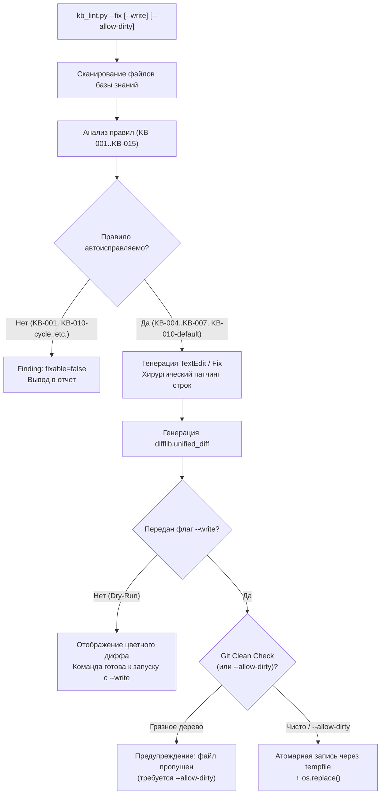

# 📋 План: PLAN-028 — Безопасный автофикс kb_lint --fix (Safe Auto-Fix, P0)

> **ID:** PLAN-028 | **Статус:** Обсуждение (Proposed) | **Фаза:** 31  
> **Спецификация:** [[../../SPEC|SPEC.md]] | **Канбан:** [[../Kanban|Канбан-доска]]  
> **Нормативная база:** [[../../03_Decisions_ADR/ADR-0036-kb-lint-safe-autofix-standard|ADR-0036: Стандарт безопасного автофикса kb_lint]]  
> **Исследовательская база:** [[../../04_Research/RESEARCH-030-kb-lint-safe-autofix|RESEARCH-030: Архитектура безопасного автофикса]]  
> **Дорожная карта:** [[../Roadmap|Дорожная карта (Волна 1: Docs Integrity Gate)]]

---

## 1. Контекст и цели (Problem & Goals)

В рамках Фазы 27 линтер `scripts/kb_lint.py` был оформлен как машиночитаемый шлюз качества первого уровня (Tier 1 Quality Gate), а в Фазе 30 дополнен контролем графа зависимостей (`KB-010`).

Однако сейчас `kb_lint.py` работает только в режиме чтения. При обнаружении тривиальных, чисто синтаксических отклонений (висячие пробелы, отсутствие обязательного дефолтного поля `depends_on: []` в спецификациях, опечатки в форматах дат `YYYY.MM.DD` или отсутствие завершающего перевода строки `\n`) разработчик или AI-агент вынужден тратить время и turn'ы диалога на ручную правку файлов.

### Главные цели Фазы 31:
1. **Реализовать безопасный флаг `--fix`:** автоматическое устранение детерминированных нарушений без риска повреждения базы знаний.
2. **Протокол Zero Data Loss:** режим безопасного предпросмотра (`--dry-run`) по умолчанию с отображением цветного диффа; фактическая запись только при явном флаге `--write`.
3. **Хирургический строковый патчинг (Zero-Dependencies):** 100% сохранение комментариев пользователей (`# ...`), исходных отступов и структуры файлов без привлечения внешних библиотек парсинга (в строгом соответствии с [[../../03_Decisions_ADR/ADR-0001-zero-dependencies-python-stdlib|ADR-0001]]).
4. **Машинно-читаемый контракт автофикса:** интеграция признаков `fixable: true/false` и блоков `fix` в JSON и SARIF форматы.
5. **Поставка в инсталлятор и скиллы:** упаковка в `install.py`, интеграция в скиллы `/kb-lint` и `/kb-complete`, актуализация документации Living Spec.

---

## 2. Обсуждение и решения (Q&A)

* **Q1: Почему флаг `--fix` по умолчанию не пишет сразу на диск?**
  * **Решение:** По стандарту [[../../03_Decisions_ADR/ADR-0036-kb-lint-safe-autofix-standard|ADR-0036]], модификация документации должна быть безопасной по умолчанию (Safe-by-Default). Вызов `kb_lint.py --fix` работает как `--dry-run` и генерирует наглядный унифицированный дифф (`git diff`-подобный вывод). Для записи на диск требуется явное подтверждение флагом `--write` (например, `python scripts/kb_lint.py --fix --write`).
* **Q2: Будет ли линтер пытаться «чинить» битые викиссылки (`KB-001`) или циклы зависимостей (`KB-010`)?**
  * **Решение:** **Категорически нет.** Автофикс разрешён исключительно для 5 детерминированных безальтернативных правил (`KB-004`, `KB-005`, `KB-006`, `KB-007` и вставка дефолтного `depends_on: []` в `Specs/`). Попытка угадать целевую заметку для битой ссылки (fuzzy matching) или разорвать цикл зависимостей несёт критический риск смыслового искажения архитектуры и процесса.
* **Q3: Как обеспечивается сохранность файлов при аварийном завершении процесса?**
  * **Решение:** Модифицированный контент сначала пишется во временный файл в том же каталоге (`tempfile.NamedTemporaryFile`), после чего производится атомарная замена через `os.replace()`. Перед записью выполняется проверка Git-Clean Guard (`git status --porcelain <file>`), предотвращающая случайное затирание незакоммиченных правок без явного флага `--allow-dirty`.
* **Q4: Как автофикс отразится на бюджете размера инсталлятора?**
  * **Решение:** Добавление логики автофикса в `scripts/kb_lint.py` оценивается примерно в +150–200 строк чистого кода на стандартной библиотеке Python (`difflib`, `re`, `os`, `tempfile`). При сжатии gzip/zlib в `install.py` это добавит не более 1.5–2.0 КБ, что с большим запасом укладывается в бюджет 210 КБ (текущий фактический размер `install.py` — 191.1 КБ).

---

### Research Basis & Unvalidated Assumptions
* **Известно (проверено в RESEARCH-030):**
  - Прототип хирургического патчинга на полной базе знаний (278 файлов) выполняется за **24.5 мс** ($< 3\text{ МБ}$ RAM).
  - Алгоритм гарантирует сохранение 100% пользовательских комментариев и отступов во frontmatter.
  - Режим унифицированного диффа через `difflib.unified_diff` работает быстро и полностью в рамках стандартной библиотеки Python 3.
* **Не проверено (гипотезы):**
  - Поведение Git-Clean Guard в средах без Git (например, при распаковке тарбола без `.git/`) — должно мягко деградировать и не блокировать работу при отсутствии Git.
* **Как закрываем:**
  - Реализация безопасного фоллбека в `TASK-113` и покрытие юнит-тестами для сред без Git.

---

## 3. Архитектурное влияние и риски

### Prior-Art Gate (Существующие решения и платформенные аналоги):
* **Внутренний аудит:** В проекте уже есть парсер frontmatter и линтер `scripts/kb_lint.py`. Расширение функционала выполняется строго внутри существующего монолита без дробления на мелкие утилиты.
* **Внешний аудит:** Индустриальные стандарты `ruff --fix` и `eslint --fix` доказали высокую надежность разделения на safe/unsafe фиксы и генерацию предпросмотра диффа. Сторонние библиотеки не используются ради Zero-Dependencies.

---

## 4. Декомпозиция задач (Task Breakdown)

### 🔹 TASK-113: Ядро хирургического автофикса в scripts/kb_lint.py
* **Скоуп:**
  - Реализация модели `Fix` и механизма генерации точечных правок.
  - Флаги командной строки: `--fix`, `--dry-run`, `--write`, `--allow-dirty`.
  - Реализация 5 безопасных автофиксов:
    * `KB-004`: нормализация разделителей `---` frontmatter.
    * `KB-005`: нормализация формата дат (`YYYY-MM-DD`).
    * `KB-006`: удаление концевых пробелов во всех строках.
    * `KB-007`: обеспечение ровно одного завершающего перевода строки `\n` EOF.
    * `KB-010`: безопасная вставка дефолтного поля `depends_on: []` в спецификации `02_Tasks/Specs/`.
  - Генерация цветного унифицированного диффа через `difflib`.
  - Атомарная запись через `tempfile.NamedTemporaryFile` + `os.replace`.
  - Git-Clean Guard с безопасным фоллбеком при отсутствии репозитория Git.
  - Набор модульных тестов `tests/test_kb_lint_fix.py` (все 5 правил, флаги, дифф, атомарность, чистый/грязный git).

### 🔹 TASK-114: Машинно-читаемый контракт, форматы отчётов и интеграция в скиллы
* **Скоуп:**
  - Обновление модели `Finding`: булево поле `fixable: bool` и сериализация блока `fix`.
  - Обновление рендереров вывода:
    * `--format text`: компактный дифф и статистика (`Fixed X issues in Y files`).
    * `--format json`: поле `fixable` и блок с описанием и диффом.
    * `--format sarif`: добавление SARIF-совместимого объекта `fixes` в результаты анализа.
  - Контрактные тесты форматов вывода при `--fix`.
  - Обновление скиллов:
    * `.agents/skills/kb-lint/SKILL.md`: документирование запуска автофикса и опций `--write`.
    * `.agents/skills/kb-complete/SKILL.md`: вызов автофикса при обнаружении тривиальных ошибок форматирования на этапе финализации задачи.
  - Дополнение раздела быстрого старта в `docs/Onboarding.md`.

### 🔹 TASK-115: Бандлинг в install.py, CI-хуки, Living Spec и поставка
* **Скоуп:**
  - Пересборка монолитного инсталлятора `install.py` через `scripts/build_installer.py`.
  - Актуализация `action.yml` (опция `fix: true/false` или запуск с автофиксом) и `.pre-commit-hooks.yaml`.
  - Синхронизация документации Living Spec: `SPEC.md` (подраздел 2.2 для флагов автофикса `kb_lint.py`) и `README.md`.
  - Калибровка бюджетов размера и токенов в `tests/test_installer.py` ($\le 210\text{ КБ}$).
  - Сквозное E2E тестирование `test_39_kb_lint_autofix_delivery` в `tests/test_installer.py` (чистая установка, проверка работы `--fix` и `--write` в установленном проекте).

---

## 5. Критерии приемки плана (DoD Режима 1)

- [x] Концепция и архитектурный стандарт согласованы на базе `RESEARCH-030` и `ADR-0036` (READ-ONLY, без изменения кода).
- [x] Дорожная карта `Roadmap.md` дополнена Фазой 31 с задачами TASK-113, TASK-114, TASK-115.
- [x] Карточка плана добавлена в `Kanban.md` в `📥 Бэклог (Backlog)`.
- [x] База знаний проверена через `scripts/kb_lint.py --path docs` (0 broken links).
- [x] Изменения зафиксированы в Git и отправлены в `origin/main`.
