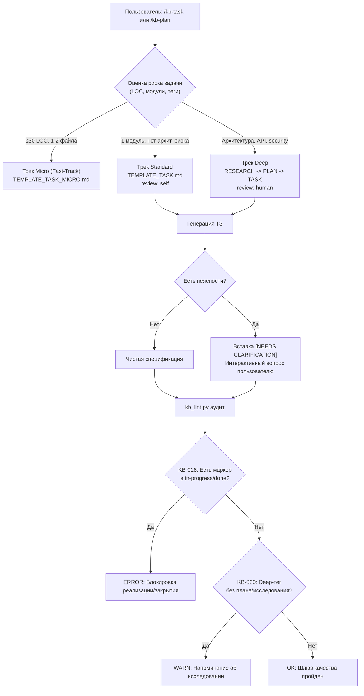

# 📋 План: PLAN-029 — Right-Sizing процесса и Spec Quality Gate (Фаза 32, P1)

> **ID:** PLAN-029 | **Статус:** Обсуждение (Proposed) | **Фаза:** 32  
> **Спецификация:** [[../../SPEC|SPEC.md]] | **Канбан:** [[../Kanban|Канбан-доска]]  
> **Нормативная база:** [[../../03_Decisions_ADR/ADR-0037-wave-2-quality-and-evidence-standard|ADR-0037: Стандарт Quality & Evidence]]  
> **Исследовательская база:** [[../../04_Research/RESEARCH-031-wave-2-quality-and-evidence-architecture|RESEARCH-031: Инженерная архитектура Волны 2]]  
> **Дорожная карта:** [[../Roadmap|Дорожная карта (Волна 2: Quality & Evidence)]]

---

## 1. Контекст и цели (Problem & Goals)

После завершения Волны 1 (Docs Integrity Gate, Фазы 27–31) харнесс Docs-as-Code получил непрерывный CI-контроль, детерминированную навигацию `kb_state.py`, граф зависимостей `depends_on` (`KB-010`) и хирургический автоисправитель `kb_lint --fix`. Базовые риски повреждения и рассинхронизации документации устранены.

Однако при переходе к активной разработке выявились две взаимосвязанные проблемы калибровки процесса и качества требований:
1. **Процедурная жесткость (Rigid Ceremony vs Cowboy Coding):** До сих пор процесс разработки имел бинарную развилку: либо ультра-легкий Fast-Track (≤30 LOC, ≤2 файла), либо полномасштабный цикл Режим 0 $\to$ 1 $\to$ 2 $\to$ 3. 80% средних изолированных задач (в рамках 1 модуля) вынуждены проходить тяжелый ритуал планирования, а глубокие изменения ядра иногда создаются без обязательного исследовательского обоснования.
2. **«Синдром уверенного угадывания» (Speculative Hallucinations):** При составлении ТЗ в Режиме 2 (`/kb-task`) AI-агент при недостатке контекста или неясности требований склонен додумывать детали реализации, API и параметры вместо того, чтобы задать уточняющий вопрос разработчику. Неверно спроектированные требования приводят к ошибкам при реализации в Режиме 3.

### Главные цели Фазы 32:
1. **Матрица Right-Sizing (`micro / standard / deep`):** Формализовать три трека разработки по уровню риска в шаблонах, руководстве `Onboarding.md` и поведении скиллов `/kb-plan` и `/kb-task`.
2. **Правило `KB-020` (Deep-Risk Tag Guard) в `kb_lint.py`:** Механический контроль — выдавать неблокирующее предупреждение (WARN) для задач и планов с тегами глубокого риска (`architecture`, `security`, `migration`, `public-api`) при отсутствии родительского плана или исследовательской базы (`research_basis`).
3. **Spec Quality Gate & Маркеры `[NEEDS CLARIFICATION]`:** Закрепить запрет на спекулятивное додумывание требований. Ввести синтаксический маркер `[NEEDS CLARIFICATION: ...]` и чек-лист качества ТЗ в `TEMPLATE_TASK.md` (§0 Spec Quality Checklist).
4. **Правило `KB-016` (Spec Quality Guard) в `kb_lint.py`:**
   - Для статуса `planned`: предупреждение (WARN).
   - Для статусов `in-progress` и `done`: блокирующая ошибка (ERROR). Задачу нельзя брать в работу или закрывать без разрешения всех маркеров.
5. **Нормативное закрепление в правилах и инсталляторе:** Обновить `rules/AGENTS_CORE.md`, регенерировать адаптеры, упаковать изменения в `install.py` и подтвердить сквозными E2E тестами.

---

## 2. Обсуждение и решения (Q&A)

* **Q1: Почему Right-Sizing вынесен в первый шаг Волны 2?**
  * **Решение:** Right-Sizing служит базисом для всех последующих шлюзов Волны 2 (трассировка «сценарий $\to$ тест» `KB-017`, двухстадийное ревью `KB-018` и дельта-спецификации `KB-019`). Без явной классификации трека (`track: micro | standard | deep`) невозможно определить строгость проверок: например, для `micro` чек-лист качества избыточен, для `standard` ревью выполняет сам агент (`reviewer: self`), а для `deep` требуется человеческое подтверждение (`reviewer: human`).
* **Q2: Будет ли правило `KB-020` блокировать CI (Exit code 1)?**
  * **Решение:** Нет. Правило `KB-020` является предупреждающим (SEVERITY_WARNING). Согласно канону человеческих барьеров («Направляй, а не блокируй», ADR-0022), линтер предупреждает агента и разработчика о высоком риске, но оставляет финальное решение человеку.
* **Q3: Как агент должен реагировать на маркер `[NEEDS CLARIFICATION]` в ТЗ?**
  * **Решение:** В Режиме 2 (`/kb-task`) при обнаружении развилки агент формулирует варианты выбора (A vs B) и ставит маркер `[NEEDS CLARIFICATION: <вопрос>]`. В Режиме 3 (`/kb-implement`) агент **категорически не имеет права** начинать кодирование, пока маркер не будет снят пользователем. Попытка перевести задачу в `in-progress` с маркером блокируется правилом `KB-016`.
* **Q4: Нужна ли миграция старых задач под новое поле `track`?**
  * **Решение:** Нет. Действует принцип обратной совместимости. Задачи без поля `track` по умолчанию интерпретируются как `standard` (или `micro`, если parent_plan отсутствует и размер $\le 30$ LOC). Автофикс `kb_lint --fix` может опционально подставлять `track: standard`.

---

### Research Basis & Unvalidated Assumptions
* **Известно (проверено в RESEARCH-031):**
  - Сканирование маркеров `[NEEDS CLARIFICATION]` на 115 спецификациях выполняется за **11.87 мс** (0 накладных расходов).
  - Эвристика детекции deep-тегов (`KB-020`) отрабатывает за **13.90 мс** и дает ровно 0 ложных срабатываний на текущей базе знаний.
* **Не проверено (гипотезы):**
  - Точность классификации трека агентом при составлении ТЗ в интерактивном диалоге.
* **Как закрываем:**
  - Внедрение подсказок выбора трека в скилл `/kb-task` с явным подтверждением пользователя и покрытие юнит-тестами.

---

## 3. Архитектурное влияние и риски

### Prior-Art Gate (Существующие решения и платформенные аналоги):
* **Внутренний аудит:** В проекте уже есть `scripts/kb_lint.py` с реестром `KB-001..KB-015`. Новые правила `KB-016` и `KB-020` логично расширяют реестр без создания сторонних утилит.
* **Внешний аудит:** Подходы Spec Kit (маркеры `[NEEDS CLARIFICATION]`) и BMAD (Right-Sized Tracks) доказали эффективность в снижении ошибок проектирования при сохранении темпа работы.

---

## 4. Декомпозиция задач (Task Breakdown)

### 🔹 TASK-116: Матрица Right-Sizing, поле track и правило линтера KB-020 (Deep-Risk Guard)
* **Скоуп:**
  - Добавление поля `track: micro | standard | deep` в шаблоны `TEMPLATE_TASK.md`, `TEMPLATE_TASK_MICRO.md`, `TEMPLATE_PLAN.md` (в `docs/00_Templates/` и `templates/`).
  - Реализация правила `KB-020` в `scripts/kb_lint.py`: поиск тегов `architecture`, `security`, `migration`, `public-api` и проверка наличия `parent_plan` или `research_basis`.
  - Регистрация `KB-020` в `RULES` и `RULE_SEVERITY_DEFAULT`.
  - Модульные тесты правила в `tests/test_kb_lint.py`.

### 🔹 TASK-117: Spec Quality Gate: маркеры [NEEDS CLARIFICATION], чек-лист ТЗ и правило KB-016
* **Скоуп:**
  - Добавление раздела `## 0. Spec Quality Checklist` в `TEMPLATE_TASK.md`.
  - Синтаксический маркер `[NEEDS CLARIFICATION: ...]` в шаблонах.
  - Реализация правила `KB-016` в `scripts/kb_lint.py`:
    * Статус `planned`: SEVERITY_WARNING.
    * Статусы `in-progress` и `done`: SEVERITY_ERROR.
  - Регистрация `KB-016` в реестре `RULES` и поддержка во всех форматах вывода (`text`, `json`, `sarif`).
  - Модульные тесты правила в `tests/test_kb_lint.py`.

### 🔹 TASK-118: Поведение скиллов, онбординг и корпус правил rules/AGENTS_CORE.md
* **Скоуп:**
  - Актуализация скилла `/kb-plan`: автоопределение и рекомендация трека (`micro/standard/deep`), префлайт-чеки для deep-трека.
  - Актуализация скилла `/kb-task`: обязательное проставление маркеров вместо догадок, валидация чек-листа ТЗ, указание `track`.
  - Актуализация скилла `/kb-implement`: блокирующий префлайт при наличии маркеров `[NEEDS CLARIFICATION]`.
  - Обновление руководства `docs/Onboarding.md`: описание матрицы Right-Sizing и маркеров уточнения.
  - Добавление инвариантов Tier 2 в `rules/AGENTS_CORE.md` и перегенерация `AGENTS.md` и адаптеров через `scripts/gen_rules.py`.

### 🔹 TASK-119: Сборка монолита install.py, E2E тесты доставки и актуализация Living Spec
* **Скоуп:**
  - Пересборка монолитного бандла `install.py` и `dist/install.py` через `scripts/build_installer.py`.
  - Проверка и калибровка бюджетов размера бандла в `tests/test_installer.py`.
  - Сквозные E2E тесты установки и обновления с новыми шаблонами и правилами линтера.
  - Актуализация `SPEC.md` и `README.md` (Living Spec Invariant).

---

## 5. Критерии приемки плана (DoD Режима 1)

- [x] Концепция согласована с пользователем (READ-ONLY, без модификации кода).
- [ ] Дорожная карта `Roadmap.md` актуализирована (Фаза 32 зафиксирована в активном плане).
- [ ] Карточки задач `TASK-116..TASK-119` занесены в `## 📥 Бэклог (Backlog)` в `docs/02_Tasks/Kanban.md`.
- [ ] Целостность базы знаний подтверждена через `python scripts/kb_lint.py --path docs`.
