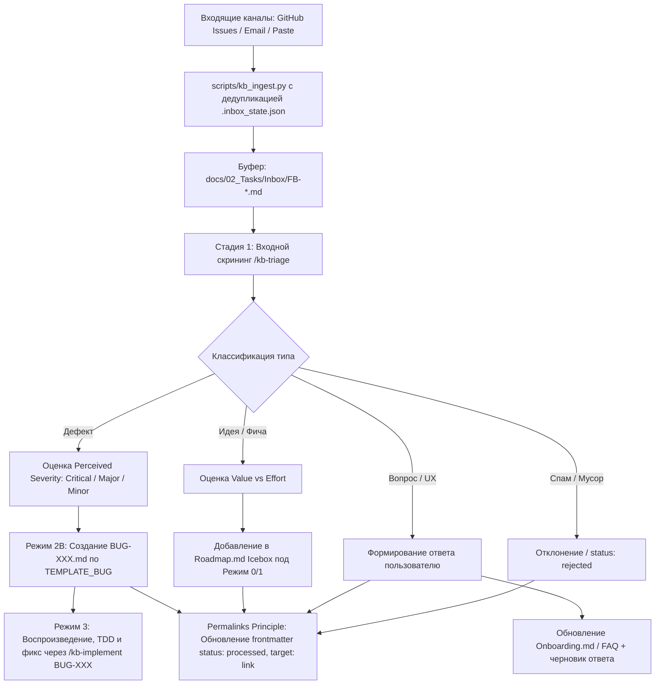

# 🔬 Исследование: Архитектура сбора обратной связи (Feedback Ingestion)

> **Теги:** #research #feedback-loops #ingestion #triage #scheduling #deduplication  
> **Канбан:** [[../02_Tasks/Kanban|Канбан-доска]] | **Дорожная карта:** [[../02_Tasks/Roadmap|Дорожная карта]]  
> **Связанные ADR:** [[../03_Decisions_ADR/ADR-0008-feedback-loops-triage-buffer-and-local-diagnostics|ADR-0008]], [[../03_Decisions_ADR/ADR-0020-feedback-ingestion-channels-and-triage-automation|ADR-0020]]

---

## 1. Проблема и проверяемые гипотезы

### 1.1. Проблема
В [RESEARCH-003](RESEARCH-003-feedback-channels-and-triage-pipeline.md) была предложена идея промежуточного буфера `docs/02_Tasks/Inbox/`, изолирующего базу знаний от сырых сигналов. Однако остался нерешенным ключевой вопрос механизма доставки:
1. **Отсутствие автоматизированного импорта (Ingestion Friction):** Ручное создание markdown-файлов пользователем или разработчиком для каждого письма или GitHub Issue создает избыточные накладные расходы.
2. **Риск дублирования (Lack of Offsets/State):** При повторном запуске сборщика без механизма фиксации смещения (offset/cursor) одни и те же обращения будут импортироваться повторно, порождая дубликаты.
3. **Неопределенность периодичности (Scheduling vs Trigger):** Как и когда запускать сбор данных — постоянным фоновым демоном, планировщиком (cron/GitHub Actions/agent scheduler) или по явному триггеру (On-Demand CLI / slash-command)?
4. **Смешение типов обратной связи:** Обращение может быть дефектом, запросом функциональности (Feature Request), вопросом по настройке (Q&A/Support) или спамом.
5. **Дилемма оценки критичности:** Когда определять тяжесть (Severity) и приоритет (Priority) — при первом осмотре или строго после воспроизведения?

### 1.2. Проверяемые гипотезы
* **Гипотеза 1 (Многоканальный сбор без внешних зависимостей):** Сбор обращений из GitHub Issues и почтового ящика (IMAP) реализуем стандартными библиотеками Python 3 (`urllib.request`, `imaplib`, `email`, `json`) в рамках Zero-Dependencies ([ADR-0001](file:///c:/Users/Koudinie/Documents/antigravityProjects/agent-docs-harness/docs/03_Decisions_ADR/ADR-0001-zero-dependencies-python-stdlib.md)).
* **Гипотеза 2 (Детерминированный офсет и дедупликация):** Файл состояния `docs/02_Tasks/Inbox/.inbox_state.json` с фиксацией ID последнего прочитанного issue, IMAP UID и хешей содержимого полностью исключает повторный импорт.
* **Гипотеза 3 (Гибридная модель периодичности):** Постоянно висящий локальный фоновый демон неэффективен и нарушает автономность. Оптимальна трехуровневая модель:
  1. *On-Demand Trigger:* Запуск разработчиком через `/kb-triage ingest` или `python scripts/kb_ingest.py`.
  2. *Scheduled Automation:* Плановый запуск по расписанию через скилл Antigravity `/schedule` или периодический workflow GitHub Actions (`workflow_dispatch` / `schedule cron`).
  3. *Quick Clip / Paste:* Мгновенная вставка произвольного текста из буфера/мессенджера прямо в диалог с агентом.
* **Гипотеза 4 (Двухстадийный триаж: Screening $\to$ Triage):** 
  - На стадии 1 (Screening) фиксируется *Perceived Severity* (воспринимаемая критичность) и тип сигнала (Defect, Feature, Question, Invalid).
  - На стадии 2 (Verification) дефекты конвертируются в `BUG-XXX` (Режим 2B), где окончательная тяжесть валидируется при создании регрессионного теста в Режиме 3 (`/kb-implement BUG-XXX`). Идеи направляются в `Roadmap.md` (Icebox) под Режим 0/1.

---

## 2. Анализ механизмов, каналов и стресс-тест

### 2.1. Каналы сбора данных

#### Канал A: GitHub Issues
* **Механика получения:**
  - Вариант 1: Использование CLI `gh issue list --state open --label needs-triage --json number,title,body,author,createdAt`.
  - Вариант 2: Прямой REST API запрос `GET /repos/{owner}/{repo}/issues?state=open&since={last_sync}` через Python `urllib.request`.
* **Идентификатор офсета:** `number` (номер issue) или ISO-таймстемп `updated_at`.
* **Формат хранения в Inbox:** `docs/02_Tasks/Inbox/FB-GH-{number}.md`.
* **Обратная связь в GitHub:** После триажа бот/скрипт снимает метку `needs-triage` и добавляет метку `triaged:bug` или `triaged:feature`.

#### Канал B: Электронная почта (Email / IMAP)
* **Механика получения:**
  - Модуль Python `imaplib.IMAP4_SSL` подключается к почтовому серверу (Gmail, Яндекс, Mail.ru, корпоративный IMAP).
  - Поиск новых писем: `SEARCH UNSEEN` или поиск по теме `SUBJECT "[Feedback]"` / фильтр папки `INBOX/Feedback`.
  - Модуль `email` извлекает заголовки (`From`, `Subject`, `Date`, `Message-ID`) и парсит текстовую часть (`text/plain` или конвертация `text/html`).
* **Идентификатор офсета:** Заголовок `Message-ID` и IMAP UID. Сохраняется в `.inbox_state.json`.
* **Формат хранения в Inbox:** `docs/02_Tasks/Inbox/FB-MAIL-{YYYYMMDD}-{hash}.md`.
* **Безопасность:** Пароли и токены приложений (App Passwords) хранятся исключительно в переменных окружения (`FEEDBACK_IMAP_PASS`) или локальном необязательном файле конфигурации `.env.local`, внесенном в `.gitignore`.

#### Канал C: Мессенджеры (Telegram, Discord, Slack)
* **Критический анализ рисков:**
  - Полноценный Telegram Bot / Slack Socket Mode требует круглосуточного сервера (VPS), открытых сокетов и постоянного процесса в фоне. Это несовместимо с моделью локального легковесного CLI-харнесса.
* **Идиоматичные решения:**
  - **Quick Paste (CLI/Agent):** Разработчик просто запускает `/kb-triage paste` или передает текст сообщения в чат: `«Разбери вот это сообщение из Telegram: ...»`.
  - **Email-Bridge:** Настройка штатной пересылки/интеграции из мессенджера на выделенный ящик обратной связи.
  - **Экспорт чата (Batch File):** Поддержка чтения сырых текстовых дампов или `.json`-файлов из `docs/02_Tasks/Inbox/Raw/`.

---

### 2.2. Периодичность и триггеры сбора: Демон vs Шедулер vs On-Demand

| Механизм | Как работает | Плюсы | Минусы и риски | Вердикт |
| :--- | :--- | :--- | :--- | :--- |
| **Постоянный демон (Background Daemon)** | Скрипт в `while True: sleep(300)` крутится в фоне ОС | Мгновенный сбор | Жрет память, падает при перезагрузке, блокирует консоль, уязвим к сбоям сети | ❌ Отклонён |
| **Системный Cron / Windows Task Scheduler** | Настройка `cron` в Linux/macOS или Планировщика Windows | Работает без участия пользователя | Платформозависим, сложная установка через `install.py`, засоряет ОС | ❌ Отклонён |
| **Облачный GitHub Actions Schedule** | Workflow `.github/workflows/feedback-sync.yml` по крону `0 */4 * * *` опрашивает issues и коммитит в ветку | Автономен в облаке, работает для любых IDE и агентов | Требует права на коммит в репозиторий, не работает в Local-Only режиме | 🟡 Опционально для GitHub |
| **Antigravity Scheduler (`/schedule`)** | Шедулер среды Antigravity вызывает периодическую проверку | Нативен для среды агента | Доступен только пока запущена сессия IDE Antigravity | 🟡 Поддерживается для Antigravity |
| **VS Code / Cursor / Windsurf Task Runner** | Автоматическая задача `.vscode/tasks.json` (`runOn: folderOpen`) | Срабатывает при открытии IDE, не тратит фон | Требует открытия IDE разработчиком | 🟡 Поддерживается для VS Code / Cursor |
| **Claude Code CLI / Terminal Pre-flight Hook** | Инструкция в `CLAUDE.md` / `AGENTS.md` проверки `Inbox/` на старте | Универсально для всех LLM-агентов | Зависит от дисциплины агента | 🟡 Поддерживается для всех агентов |
| **On-Demand CLI / Agent Trigger (`/kb-triage ingest`)** | Запуск разработчиком по требованию перед сессией триажа | 100% стабилен, контролируем, 0 фоновой нагрузки | Требует запуска команды человеком | ✅ **Основной универсальный стандарт** |

#### Кросс-агентная матрица автоматизации сбора (Multi-Agent Automation Matrix):

Харнесс `agent-docs-harness` поддерживает множество сред разработки, поэтому автоматизация сбора строится по трехуровневому принципу:

1. **Универсальный облачный уровень (Cloud Headless):**
   - Шаблон `.github/workflows/feedback-sync.yml` запускает `scripts/kb_ingest.py --github --email` каждые 4-6 часов.
   - Независимо от того, какую IDE использует разработчик (Cursor, Windsurf, Cline, Antigravity), свежие обращения появляются в `docs/02_Tasks/Inbox/` прямо из облака.
2. **Сессионный уровень конкретных IDE и сред:**
   - **Google Antigravity:** нативный скилл `/schedule` для периодического запуска сбора в активной сессии.
   - **VS Code / Cursor / Windsurf / Cline / Roo Code:** задача запуска `python scripts/kb_ingest.py` в `.vscode/tasks.json` по триггеру открытия папки (`folderOpen`).
   - **Claude Code CLI / Generic:** pre-flight правило в `CLAUDE.md` и `AGENTS.md` (автоматическая проверка папки `Inbox/` при первом обращении разработчика).
3. **Локальный On-Demand уровень (Zero Friction):**
   - Единая команда `python scripts/kb_ingest.py` и скилл `/kb-triage`, доступные разработчику в любой среде.

---

### 2.3. Двухстадийный триаж и оценка критичности



> [!IMPORTANT]
> **Принцип неизменяемости ссылок (Permalinks Invariant):**  
> Файлы обращений `FB-*.md` **никогда не перемещаются** физически в папки `Processed/` или `Archive/`, так как это ведет к эффекту Link Rot (поломке викиссылок `[[...]]`). Вместо перемещения статус файла обновляется в YAML frontmatter: `status: processed`, `triaged_date: YYYY-MM-DD`, с обязательной постоянной ссылкой на целевой артефакт `target: "[[../Bugs/BUG-XXX]]"` или `target: "[[Roadmap#Icebox]]"`.

#### Матрица тяжести (Severity) до и после воспроизведения:
1. **До воспроизведения (Входной скрининг — Perceived Severity):**
   - **S1 (Блокер/Крах):** Полная неработоспособность ключевого функционала, потеря данных. Назначается `release_blocker: true`.
   - **S2 (Мажорный дефект):** Функция не работает, но есть обходной путь (workaround).
   - **S3 (Минорный дефект):** Косметический дефект, опечатка, неточность верстки/логов.
2. **После воспроизведения (Режим 3 — Verified Severity):**
   - Уточняется разработчиком в процессе написания падающего регрессионного теста (`regression_test` в frontmatter). Если дефект не воспроизводится, статус переводится в `rejected` (Cannot Reproduce) с запросом дополнительной информации у автора.

---

## 3. Практические замеры и прототип импорта (Zero-Deps)

### 3.1. Структура файла состояния дедупликации (`.inbox_state.json`)
```json
{
  "version": 1,
  "last_sync": "2026-10-11T18:30:00Z",
  "github": {
    "last_issue_number": 42,
    "processed_ids": [39, 40, 41, 42]
  },
  "email": {
    "last_uid": 1054,
    "processed_message_ids": [
      "<CAD+12345@mail.gmail.com>",
      "<98765.smtp@yandex.ru>"
    ]
  }
}
```

### 3.2. Прототип Zero-Deps скрипта импорта (`scripts/kb_ingest.py`)
```python
import os
import sys
import json
import hashlib
from datetime import datetime
from pathlib import Path

def ingest_quick_paste(inbox_dir: Path, title: str, text: str, source: str = "paste") -> Path:
    inbox_dir.mkdir(parents=True, exist_ok=True)
    date_str = datetime.now().strftime("%Y%m%d")
    slug = "".join(c if c.isalnum() else "-" for c in title.lower())[:30].strip("-")
    content_hash = hashlib.sha256(text.encode("utf-8")).hexdigest()[:8]
    filename = f"FB-{date_str}-{slug}-{content_hash}.md"
    target = inbox_dir / filename
    
    frontmatter = f"""---
id: {filename.replace('.md', '')}
title: "{title}"
date: {datetime.now().strftime('%Y-%m-%d')}
source: {source}
status: inbox
perceived_severity: unassigned
tags:
  - feedback
  - inbox
---

# 📥 Обратная связь: {title}

**Источник:** {source}  
**Дата получения:** {datetime.now().strftime('%Y-%m-%d %H:%M')}

## Исходный текст обращения
{text}
"""
    target.write_text(frontmatter, encoding="utf-8")
    return target
```

---

## 4. Сравнительный анализ вариантов архитектуры (Trade-off Matrix)

| Архитектурное решение | Плюсы | Минусы и риски | Вердикт |
| :--- | :--- | :--- | :--- |
| **Вариант 1: Прямая интеграция внешних обращений сразу в `BUG-XXX` и `Kanban.md`** | Меньше промежуточных файлов | 70% мусора в трекере, засорение базы знаний, ложные тревоги | ❌ Отклонён |
| **Вариант 2: Фоновый серверный демон-поллер на машине разработчика** | Автоматическое получение без кликов | Процесс может зависнуть, тратит RAM/CPU, проблемы с безопасностью токенов | ❌ Отклонён |
| **Вариант 3: Автономный модуль `scripts/kb_ingest.py` + буфер `Inbox/` + скилл `/kb-triage` (On-Demand + Quick Paste + Scheduler Hooks)** | 100% Zero-Deps, надежная дедупликация через `.inbox_state.json`, разделение багов и фичей, поддержка GitHub/Email/Paste | Требует отдельной команды запуска или настройки шедулера | ✅ **Рекомендован** |

---

## 5. Отвергнутые варианты

* **Вшивание токенов мессенджеров (Telegram/Discord боты прямо в CLI):** Отклонено из-за недопустимости хранения секретов и невозможности поддерживать постоянный демон в CLI-инструменте.
* **Автоматическое назначение окончательной критичности (Verified Severity) нейросетью без участия разработчика:** Отклонено, так как только попытка воспроизведения и написание падающего теста подтверждают реальную тяжесть сбоя.

---

## 6. Выводы и нормативные правила

1. Создать буфер `docs/02_Tasks/Inbox/`. В соответствии с **Permalinks Principle** файлы `FB-*.md` не перемещаются, а меняют статус в frontmatter на `status: processed` (или `status: rejected`) со ссылкой `target: "[[...]]"`.
2. Внедрить детерминированный учет смещений в `docs/02_Tasks/Inbox/.inbox_state.json`.
3. Создать Zero-Deps утилиту `scripts/kb_ingest.py` с драйверами:
   - `github`: опрос через `gh` CLI или GitHub REST API.
   - `email`: опрос через `imaplib` с защитой учетных данных в окружении.
   - `paste`: быстрая вставка текста из мессенджеров/буфера.
4. Добавить префикс `02_Tasks/Inbox` в проверку обязательного YAML frontmatter в `scripts/kb_lint.py`.
5. Скилл `/kb-triage` обучить двухстадийному процессу: входной скрининг $\to$ маршрутизация (`BUG-XXX` / `Roadmap.md Icebox` / FAQ) $\to$ перевод в `status: processed` со `Stop & Yield`.
6. Зафиксировать решения в каноническом **`ADR-0020`**, который заменяет и расширяет `ADR-0008`.
