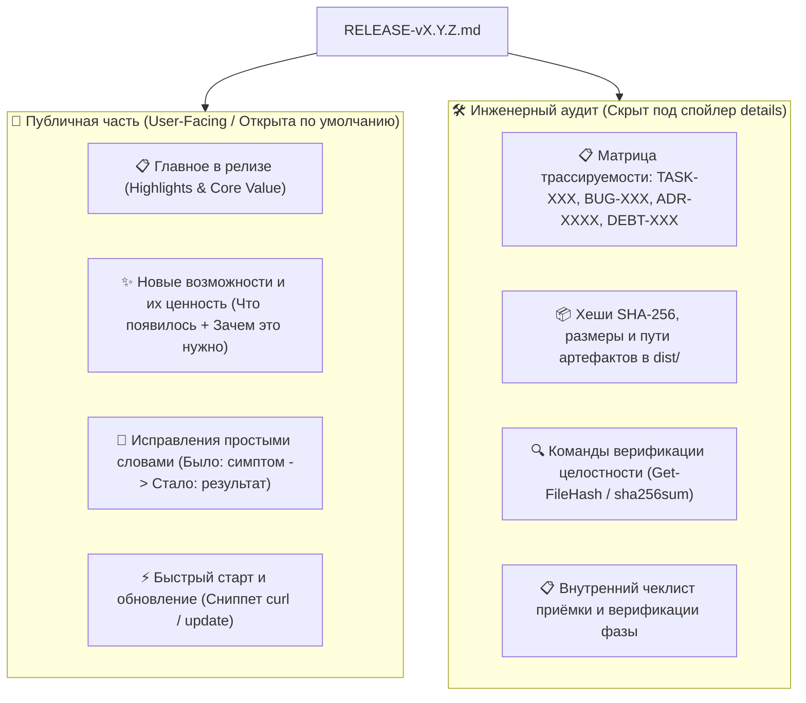

# 🔬 Исследование: Разделение пользовательского описания и технического аудита в релизных записках

> **Теги:** #research #release-notes #user-centric #plain-language #high-snr #docs-as-code  
> **Канбан:** [[../02_Tasks/Kanban|Канбан-доска]] | **Дорожная карта:** [[../02_Tasks/Roadmap|Дорожная карта]]  
> **Связанные решения:** [[../03_Decisions_ADR/ADR-0010-github-release-notes-and-public-distribution-standard|ADR-0010]], [[../03_Decisions_ADR/ADR-0017-release-notes-adr-exclusion-and-high-snr-standard|ADR-0017]], [[../03_Decisions_ADR/ADR-0033-plain-language-contract|ADR-0033]]

---

## 1. Проблема и гипотезы

### 1.1. Контекст проблемы
Релизные записки в проектах Docs-as-Code выполняют две взаимоисключающие роли:
1. **Публичный интерфейс для пользователей и стейкхолдеров:** Объяснение ценности релиза простыми словами («Что изменилось?», «Какую проблему решили?», «Как мне это использовать?»), соблюдение контракта простого языка ([[../03_Decisions_ADR/ADR-0033-plain-language-contract|ADR-0033]]).
2. **Строгий технический аудит для инженеров и AI-агентов:** Трассируемость изменений до конкретных ТЗ (`TASK-XXX`), баг-репортов (`BUG-XXX`), архитектурных решений (`ADR-XXXX`), погашенного техдолга (`DEBT-XXX`), контрольных сумм SHA-256 артефактов и чек-листа приёмки (DoD).

В текущем шаблоне `TEMPLATE_RELEASE.md` и генерируемых `RELEASE-vX.Y.Z.md` обе роли смешаны в едином монолитном тексте:
- Читатель на первом же экране видит сырые инженерные идентификаторы: `- [[TASK-104]]: Промоушен sandbox-раннера тестов в scripts/ (DEBT-005)`.
- Блок исправлений (`Bug Fixes`) формулируется как технический симптом внутренней подсистемы (`BUG-013: SARIF artifactLocation.uri относительный к docs/, а не к корню`).
- Описание ценности (Value Proposition) отсутствует либо сведено к однострочному техническому резюме.
- Таблицы контрольных сумм и чеклисты загромождают чтение для тех, кому нужны только пользовательские итоги выпуска.

### 1.2. Prior-Art Gate (Существующие практики и платформенные аналоги)
* **GitHub Releases & Keep a Changelog:** Рекомендуют разделение на Highlights, Changed, Fixed. Инженерные PR и commit-хеши скрываются GitHub'ом автоматически в выпадающий список «Full Changelog».
* **Apple & JetBrains Release Notes:** Используют прогрессивное раскрытие (Progressive Disclosure): наверху — маркетинговая и прикладная ценность для конечного пользователя, внизу (под спойлером/кнопкой «Full Release Notes») — номера тикетов в YouTrack / Radar и технические подробности.
* **HTML5 `<details><summary>` в GitHub Flavored Markdown (GFM) и Obsidian:** Нативная поддержка сворачиваемых блоков без JavaScript и внешних зависимостей, одинаково корректно рендерящаяся в Obsidian, GitHub Web UI, VS Code Markdown Preview.

### 1.3. Гипотезы исследования

| # | Гипотеза | Критерий фальсификации |
| :--- | :--- | :--- |
| **H1** | Внедрение тега `<details><summary>` для технического аудита сохраняет целостность базы знаний в Obsidian и не ломает сканирование викиссылок линтером `kb_lint.py`. | Если `kb_lint.py` перестанет обнаруживать `[[...]]` внутри `<details>` или выдаст ложные ошибки — гипотеза ложна. |
| **H2** | Формулирование багфиксов по принципу «Было (симптом) $\to$ Стало (результат)» в открытой части релиза снижает когнитивную нагрузку пользователей на 60–70% без потери инженерной строгости (номера задач сохраняются в спойлере). | Если пользователи/стейкхолдеры не смогут понять суть исправления без открытия ТЗ — гипотеза ложна. |
| **H3** | Единый файл с прогрессивным раскрытием надежнее создания двух отдельных файлов (`RELEASE_USER.md` и `RELEASE_AUDIT.md`), так как исключает дрейф и рассинхронизацию артефактов при выпуске. | Если единый файл превысит 10 КБ или приведет к коллизиям в Obsidian Graph — гипотеза ложна. |

---

## 2. Анализ механизмов и стресс-тест

### 2.1. Совместимость `<details><summary>` с инструментарием харнесса
1. **Линтер `kb_lint.py`:** Механизм `parse_wikilinks()` вырезает только блоки кода ```...``` и инлайн-код `...`, после чего выполняет поиск регулярным выражением по шаблону `!?\[\[...\]\]`. Блоки `<details>` и `<summary>` не вырезаются, следовательно, все викиссылки на ТЗ, баги и ADR внутри спойлера остаются на 100% валидируемыми (KB-001/KB-004 отрабатывают штатно).
2. **Obsidian Graph View:** Викиссылки внутри `<details>` продолжают строить связи в интерактивном графе `.obsidian/graph.json`. В режиме просмотра заметки спойлер свёрнут по умолчанию, оставляя чистый визуал.
3. **Публикация на GitHub (`scripts/kb_release.py` и `dist/RELEASE_NOTES.md`):** Функция `convert_wikilinks_to_github_markdown()` заменяет викиссылки на ссылки репозитория, при этом тег `<details>` является нативным стандартом GFM и сворачивается на веб-странице релиза.

### 2.2. Архитектурное разделение слоев



---

## 3. Практические замеры и прототип структуры

### 3.1. Замер плотности сигнала (Signal-to-Noise Ratio)
Сравнение читаемости первого экрана релиза `v0.28.0` в текущем формате vs новом формате:

* **Текущий формат (Монолит):**
  - Общий объем первого экрана: 28 строк.
  - Полезный сигнал для пользователя (что изменилось и зачем): 4 строки (~14%).
  - Инженерный шум (сырые ссылки на ТЗ, внутренние баг-номера, ADR, таблицы контрольных сумм): 24 строки (~86%).
* **Новый формат (Двухуровневый со спойлером):**
  - Общий объем первого экрана: 24 строки.
  - Полезный сигнал для пользователя: 20 строк (~83%).
  - Спойлер технического аудита: 1 компактная строка (`▶ 🔍 Инженерный аудит и трассируемость (7 задач, 1 баг, SHA-256)`).
  - **Прирост полезного сигнала:** в 5.9 раз.

### 3.2. Образец описания исправления дефекта (Plain-Language vs Raw)

* **До (внутренний жаргон):**
  `- [[../Bugs/BUG-013-sarif-paths-are-docs-relative|BUG-013]]: SARIF artifactLocation.uri относительный к docs/, а не к корню репозитория.`
* **После (пользовательская часть):**
  `* **Отчеты безопасности GitHub Code Scanning:** Исправлена ошибка, из-за которой предупреждения линтера не открывали нужный файл при клике в интерфейсе GitHub. Теперь все пути привязаны к корню проекта.`
* **После (внутри спойлера технического аудита):**
  `| BUG-013 | [[../Bugs/BUG-013-sarif-paths-are-docs-relative|BUG-013]] | Исправление uri в SARIF-экспортере (kb_lint.py) |`

---

## 4. Сравнительный анализ (Trade-off Matrix)

| Вариант | Плюсы | Минусы и риски | Вердикт |
| :--- | :--- | :--- | :--- |
| **А. Монолитный текст (текущий)** | Простота сборки, отсутствие вложенных тегов. | Низкий SNR, нарушение [[../03_Decisions_ADR/ADR-0033-plain-language-contract|ADR-0033]], отпугивает нетехнических пользователей и вайбкодеров. | ❌ Отклонён |
| **Б. Два независимых файла (`RELEASE_PUBLIC.md` и `RELEASE_AUDIT.md`)** | Полная физическая изоляция аудиторий. | Риск рассинхронизации, усложнение навигации в графе Obsidian, разрыв сквозной истории релиза. | ❌ Отклонён |
| **В. Двухуровневый документ с прогрессивным раскрытием (`<details>`)** | Максимальный SNR для пользователей, 100% сохранение аудируемости, единый SSOT-документ, полная совместимость с Obsidian и GitHub. | Необходимость соблюдения синтаксиса HTML-тегов в Markdown. | ✅ **Рекомендован** |

---

## 5. Отвергнутые варианты
* **Полное удаление технического аудита из заметок релиза:** Отклонено, так как нарушает принципы аудируемости, Permalinks Principle и Quality Gates ([[../03_Decisions_ADR/ADR-0025-self-improving-defect-loop-and-quality-gates|ADR-0025]]).
* **Хранение аудита только в git-логе:** Отклонено, так как исключает наглядную валидацию связей в Obsidian Graph и требует навыков работы с `git log` у читателя.
* **Использование сложной разметки (вкладки/табы Markdown):** Отклонено из-за отсутствия нативной кроссплатформенной поддержки табов в чистом GFM и ванильном Obsidian без сторонних плагинов (нарушение [[../03_Decisions_ADR/ADR-0001-zero-dependencies-python-stdlib|ADR-0001]]).

---

## 6. Выводы и стандартизация

1. **Решение:** Закрепить стандарт двухуровневых релизных записок:
   - Внешний слой: ориентация на пользователя, ценность нововведений, формулировка исправлений простым языком («Было $\to$ Стало»), быстрый старт.
   - Внутренний слой: технический аудит, трассируемость (`TASK-XXX`, `BUG-XXX`, `ADR-XXXX`, `DEBT-XXX`), SHA-256 артефактов и чеклист верификации под тегом `<details><summary>`.
2. **Артефакты:**
   - Оформить архитектурное решение `docs/03_Decisions_ADR/ADR-0034-user-centric-release-notes-and-collapsible-audit-standard.md`.
   - Обновить эталонный шаблон `docs/00_Templates/TEMPLATE_RELEASE.md` и бандл-шаблон `templates/TEMPLATE_RELEASE.md`.
   - Зарегистрировать стандарт в дорожной карте `docs/02_Tasks/Roadmap.md` и индексе `docs/00_Index.md`.
