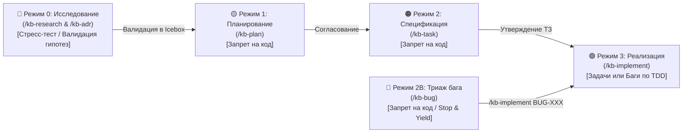

# 🚀 Руководство по онбордингу: agent-docs-harness

> **Назначение:** Единая точка входа для разработчиков и AI-агентов. Описывает архитектуру проекта, 4 режима разработки (Discovery + Delivery), правила внесения изменений и быстрые команды.  
> **Связанные документы:** [[00_Index|00_Index (Карта заметок)]], [[02_Tasks/Kanban|Канбан-доска]], [[02_Tasks/Roadmap|Дорожная карта]], [[Devlog|Журнал разработки]].

---

## 1. Концепция проекта

`agent-docs-harness` — это автономный инструмент (Zero Dependencies, Python 3), упаковывающий эталонную методологию **Docs-as-Code** и строгий **4-этапный процесс взаимодействия с AI-агентами (Discovery + Delivery)** для развертывания в любых пользовательских проектах за одну команду:
```bash
curl -sSL https://raw.githubusercontent.com/koudinie101-png/agent-docs-harness/main/install.py | python3
```

Сам проект полностью следует этой же методологии (**Dogfooding**).

---

## 2. Четыре режима взаимодействия (Operating Modes)

Работа над любой инициативой, гипотезой, задачей или дефектом проходит через структурированный жизненный цикл:



### 🔬 Режим 0: Исследование и валидация гипотез (Discovery & Feasibility)
* **Цель:** Предварительная валидация продуктовых и архитектурных идей, стресс-тестирование гипотез, анализ компромиссов (Trade-off Matrix) и платформенных рисков ДО начала планирования.
* **🚨 ЖЕСТКИЙ ЗАПРЕТ:** **Никакого изменения рабочего кода!** Разрешены только изолированные замеры и чтение.
* **Результат:**
  - *Одобрено:* Создается `docs/04_Research/RESEARCH-XXX-<slug>.md` (+ `ADR-XXXX` при необходимости), идея автоматически регистрируется в секции `## 🔮 Перспективные направления (Icebox)` в [[02_Tasks/Roadmap|Roadmap.md]].
  - *Отклонено:* Агент аргументированно фальсифицирует гипотезу, оформляет отказной ADR (`status: rejected`) через `/kb-adr` и регистрирует идею в секции `## 🚫 Отклоненные архитектурные идеи` в `Roadmap.md`.

### 🟡 Режим 1: Планирование (Planning / RFC)
* **Цель:** Концептуальное обсуждение, Q&A, архитектурный анализ, выявление рисков.
* **🚨 ЖЕСТКИЙ ЗАПРЕТ:** **Никакого изменения рабочего кода!** Разрешено только чтение.
* **Результат:** Создается файл `docs/02_Tasks/Plans/PLAN-XXX-<slug>.md`, карточка добавляется в `Бэклог` на Канбане.

### 🟠 Режим 2: Формирование задачи (Task Specification)
* **Цель:** Детальное техническое задание перед написанием кода.
* **🚨 ЖЕСТКИЙ ЗАПРЕТ:** **Никакого изменения рабочего кода!**
* **Результат:** Создается файл `docs/02_Tasks/Specs/<Phase>/TASK-XXX-<slug>.md`. Фиксируются:
  - Точный список файлов: `[NEW]`, `[MODIFY]`, `[DELETE]`.
  - Контракты, сигнатуры, обработка ошибок.
  - План верификации (команды сборки, автотесты, шаги проверки).
  - Карточка переносится в `В работе` на Канбане.

### 🐞 Режим 2B: Заведение и триаж дефекта (Defect Logging & Triage)
* **Цель:** Изолированная диагностика сбоя, RCA и фиксация релизного контракта без попыток несанкционированного авто-исправления кода.
* **🚨 ЖЕСТКИЙ ЗАПРЕТ:** **Никакого изменения кода и никакого запуска тестов!**
* **Результат:** Создается файл `docs/02_Tasks/Bugs/BUG-XXX-<slug>.md`. Фиксируются:
  - Релизный контракт: `target_release`, `target_phase`, `release_blocker`, `regression_test`.
  - Анализ первопричины (RCA) и план исправления по TDD.
  - Карточка добавляется на Канбан.
  - **Терминальный шаг Stop & Yield Control:** Агент останавливает вызовы инструментов и возвращает управление разработчику.

### 🟢 Режим 3: Реализация и верификация (Implementation & Verification)
* **Цель:** Написание кода задач строго по ТЗ либо устранение дефектов строго по TDD-циклу.
* **🚨 БАРЬЕР ЕДИНИЧНОЙ ЗАДАЧИ:** Команда `/kb-implement <TASK-XXX | BUG-XXX>` авторизует работу **строго над одной задачей или дефектом**. Агенту **категорически запрещено** самовольно переходить к следующим задачам в очереди.
* **Результат:**
  1. Код написан строго по спецификации (или по циклу TDD: **RED** -> **GREEN** -> **REFACTOR** для `BUG-XXX`).
  2. Все пункты плана верификации успешно пройдены.
  3. Статус в ТЗ: `Выполнено` (для бага: `status: fixed`, `fixed_in: "vX.Y.Z"`).
  4. В `Kanban.md`: карточка перенесена в `Done` с датой `(YYYY-MM-DD)`.
  5. В `Roadmap.md`: пункт отмечен `[x]` с пермалинком на ТЗ или дефект.
  6. В `Devlog.md`: добавлена запись с отчетом и маркером ожидания команды пользователя (`- **Рекомендуемый следующий шаг (Ожидает команды пользователя):**`).
  7. Аудит базы знаний через `kb_lint.py` (0 broken links).
  8. Git commit и push.
  9. **Терминальный шаг (Stop & Yield Control):** Немедленная остановка вызовов инструментов и возврат управления человеку.

---

## 3. Релиз-менеджмент и жизненный цикл (/kb-release)

Выпуск версий и завершение фаз проекта автоматизируется скиллом `/kb-release` и утилитой `scripts/kb_release.py`:

```
┌────────────────────────────────────────────────────────────────────────┐
│                   КАНАЛЫ ВЫПУСКА РЕЛИЗОВ (DUAL-MODE)                   │
├───────────────────────────────────┬────────────────────────────────────┤
│ 🐙 Режим GitHub (Remote Repo)     │ 💻 Локальный режим (Local-Only)    │
├───────────────────────────────────┼────────────────────────────────────┤
│ • Git remote origin настроен      │ • Локальный репозиторий / оффлайн  │
│ • Автоматический тег vX.Y.Z       │ • Без удаленного репозитория       │
│ • Публикация релиза через gh CLI  │ • Локальный архив в dist/          │
│ • GitHub Actions CI (release.yml) │ • Контрольные суммы SHA-256        │
│ • Документ в 02_Tasks/Releases/   │ • Документ в 02_Tasks/Releases/    │
└───────────────────────────────────┴────────────────────────────────────┘
```

### Регламент подготовки релиза
1. **Pre-flight проверки:**
   - Чистота рабочей копии Git (`git status`).
   - Успешный прогон тестов (`python -m unittest discover -s tests`).
   - Отсутствие битых ссылок (`python scripts/kb_lint.py --path docs`).
   - Все задачи целевой фазы закрыты в [[02_Tasks/Roadmap|Дорожной карте]].
2. **Build Hook Contract:**
   - Сборщик проекта компилирует бинарные пакеты в каталог `dist/` (например, `scripts/build_release.py`, `package.json`, `Cargo.toml`).
3. **Генерация артефактов и контрольных сумм (High-SNR Dual-Export):**
   - Расчет потоковых SHA-256 хэшей для каждого файла в `dist/`.
   - Формирование публичных заметок в `dist/RELEASE_NOTES.md` без внутренних технических протоколов ADR согласно [[03_Decisions_ADR/ADR-0017-release-notes-adr-exclusion-and-high-snr-standard|ADR-0017]].
   - Автоматическое формирование внутренней заметки `docs/02_Tasks/Releases/RELEASE-vX.Y.Z.md` по шаблону [[00_Templates/TEMPLATE_RELEASE|TEMPLATE_RELEASE]] со списком задач, дефектов и фазово-изолированных решений ADR.
4. **Синхронизация базы знаний:**
   - Отметка завершения фазы в [[02_Tasks/Roadmap|Дорожной карте]] и запись в [[Devlog|Devlog.md]].

---

## 4. Стек технологий и команды проекта

* **Язык разработки:** Python 3 (Python 3.8+) без внешних зависимостей.
* **Проверка линтером:**
  ```bash
  python scripts/kb_lint.py --path docs
  ```
* **Формирование релиза:**
  ```bash
  python scripts/kb_release.py --version vX.Y.Z --phase N
  ```
* **Запуск инсталлятора локально:**
  ```bash
  python install.py --help
  python install.py --non-interactive --name "DemoProject" --stack swift --agent all --git local --target-dir test_sandbox
  ```
* **Запуск E2E тестов:**
  ```bash
  python -m unittest discover -s tests
  ```

---

## 5. Контроль версий и дисциплина Git

* Все изменения документации фиксируются коммитами в `main`.
* Принцип **Permalinks**: файлы ТЗ и багов **никогда не перемещаются** в архивные директории при закрытии.
* Принцип **Regression-First**: любой баг закрывается только при наличии теста, подтверждающего устранение сбоя.

---

## 6. High-SNR архитектура и контекстная эффективность

Для предотвращения деградации контекста модели при длительных сессиях действует стандарт [[03_Decisions_ADR/ADR-0009-high-snr-token-architecture-and-context-efficiency|ADR-0009]]:
* **Micro-Descriptions (-53%):** Описания скиллов в YAML frontmatter сжаты до 10–13 слов, снижая постоянный налог системного реестра.
* **Progressive Disclosure Router:** Мастер-скилл `docs-as-code` работает как легковесный индекс (~2.2 КБ), раскрывая подробности по требованию.
* **Skeleton Templates (-49%):** 13 шаблонов `docs/00_Templates/` сведены к компактным каркасам с однострочными директивами `<!-- prompt -->`.
* **Anti-Echo Protocol:** Запрещена перепечатка содержимого файлов в чат — ответ содержит permalink `[File](file://...)`, 3–5 пунктов резюме и следующий шаг.
* **Silent-on-Success CLI:** Скрипты `kb_lint.py` и `kb_release.py` при успехе выводят ровно одну строку, экономя токены истории вывода.

---

## 7. Greenfield-старт от идеи и протокол Living Spec

* **Greenfield Idea-First (`install.py --idea "<идея>"`):** Инициализация проекта с пресетом `undecided`. `SPEC.md` создается в статусе `status: discovery`. Первый шаг — запуск Режима 0 (`/kb-research <выбор-стека-и-архитектуры>`), который исследует стек, оформляет `ADR-0001` и переводит `SPEC.md` в статус `status: active`.
* **Living Spec Invariant:** Спецификация `SPEC.md` и `README.md` поддерживаются как Единый Источник Истины (Single Source of Truth). При изменении публичных интерфейсов или контрактов они актуализируются в той же сессии (`/kb-complete`). Перед срезом релиза (`/kb-release`) выполняется префлайт-контроль их актуальности.
* **Эвристический контроль дрифта:** Линтер `scripts/kb_lint.py` автоматически отслеживает соотношение завершенных фаз в Дорожной карте и даты обновления `SPEC.md`, напоминая о необходимости синхронизации мастер-спецификации (`⚠️  WARN: Living Spec Drift`).

---

## 8. Барьер единичной задачи и протокол остановки (Single-Task Barrier)

Для исключения неконтролируемого автономного чейнинга задач в харнессе действует трехслойный защитный барьер ([[03_Decisions_ADR/ADR-0016-single-task-execution-barrier-and-stop-on-complete-protocol|ADR-0016]], [[04_Research/RESEARCH-012-single-task-execution-barrier-and-autonomous-pipeline-containment|RESEARCH-012]]):
1. **Нормативный барьер (`AGENTS.md`):** Прямой запрет на выполнение более одного ТЗ за сессию команды `/kb-implement`. Любые указания на "следующие шаги" носят статус рекомендации для человека и не являются директивой на исполнение для агента.
2. **Семантический маркер в Devlog:** Рекомендуемые шаги всегда сопровождаются маркером ожидания команды пользователя: `- **Рекомендуемый следующий шаг (Ожидает команды пользователя):**`. Линтер `scripts/kb_lint.py` выдает предупреждение, если этот маркер отсутствует.
3. **Терминальный шаг Stop & Yield:** В конце сценариев `/kb-implement` и `/kb-complete` агент выводит компактный Anti-Echo отчет и **полностью прекращает вызовы инструментов**, ожидая явной команды пользователя для следующей задачи.

---

## 9. Протокол рождения Мастер-Спецификации (Spec Genesis) и Zero-State Guardrails

Для предотвращения неконтролируемых галлюцинаций в пустом репозитории и гарантии создания достоверного Единого Источника Истины (Single Source of Truth) действует регламент [[03_Decisions_ADR/ADR-0018-spec-genesis-protocol-and-zero-state-handling|ADR-0018]]:
1. **Категорический отказ от слепой автогенерации:** Агенту строго запрещено выдумывать бизнес-требования, целевой стек или архитектуру «из головы» при отсутствии прямого диалога с пользователем.
2. **Три состояния зрелости спецификации:**
   * **Missing (Zero-State):** `SPEC.md` отсутствует. Агент не блокирует точечные запросы, но перед планированием (`/kb-plan`) выдает предупреждающий Soft Nudge.
   * **Discovery (Исследование):** `SPEC.md` находится в `status: discovery` (содержит сырую идею). Агент распознает этап выбора технологий и предлагает провести Режим 0 (`/kb-research`).
   * **Active (Мастер-Спецификация):** После выбора стека и утверждения `ADR-0001` спецификация переводится в `status: active`. Все последующие ТЗ и планы опираются на нее как на подтвержденный контракт.
3. **Цепочка кристаллизации:** `Сырая идея -> /kb-research -> ADR-0001 -> SPEC.md (status: active)`.

---

## 10. Жизненный цикл дефектов и релизный таргетинг (Bug Lifecycle & Release Targeting)

Для предотвращения хаотичного самовольного исправления багов (Eager Auto-Fixing) и обеспечения прозрачности релизов действует регламент [[03_Decisions_ADR/ADR-0019-bug-lifecycle-triage-and-release-targeting|ADR-0019]] и [[04_Research/RESEARCH-014-bug-lifecycle-triage-and-release-targeting|RESEARCH-014]]:
1. **Изоляция триажа от исправления (Режим 2B `/kb-bug`):** Заведение дефекта происходит строго в режиме анализа. Агенту категорически запрещено модифицировать код проекта и запускать тесты. Агент диагностирует проблему, находит первопричину (RCA), формулирует воспроизводящий тест, задает релизные параметры (`target_release`, `target_phase`, `release_blocker`, `regression_test`) и выполняет немедленный **Stop & Yield Control**.
2. **Строгий TDD-пайплайн устранения дефектов (Режим 3 `/kb-implement BUG-XXX`):** Исправление дефекта инициируется только по явной команде разработчика и проходит три фазы:
   * **RED:** Запуск воспроизводящего теста `regression_test` и подтверждение его падения (Exit code != 0).
   * **GREEN:** Внесение минимального кода исправления и подтверждение успешного прохождения теста (Exit code 0).
   * **REFACTOR:** Прогон полного тестового набора репозитория и линтера `kb_lint.py`.
3. **Автоматическая финализация дефекта (`/kb-complete`):** Простановка `status: fixed`, заполнение `fixed_in: "<target_release>"`, перемещение карточки дефекта в `Done` на Канбане и коммит `fix(...)`.
4. **Релизная изоляция и префлайт-блокеры (`scripts/kb_release.py`):** В чейнджлоги релиза включаются только дефекты, устраненные именно в целевом выпуске (`fixed_in == target_version` или `target_release == target_version`). Наличие любого открытого бага (`status: open | in-progress`) с флагом `release_blocker: true` немедленно блокирует сборку релиза с кодом ошибки 1.

