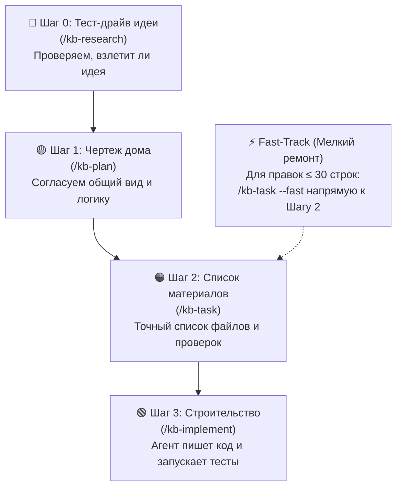

# 🛡️ Zero to Hero: Практический гайд по безопасной агентной разработке

> **Концепция:** «Вайбкодинг со страховкой» (Protected Vibe Coding)  
> **Для кого:** Для начинающих разработчиков, вайбкодеров и авторов pet-проектов, которые хотят создавать работающие приложения с помощью AI-агентов, не боясь всё сломать.  
> **Связанные документы:** [[Onboarding|Полное руководство по онбордингу]], [[00_Index|Карта знаний]], [[02_Tasks/Kanban|Канбан-доска]].

---

## 1. Что такое «Вайбкодинг со страховкой»?

### Ловушка «наивного» вайбкодинга
Когда вы впервые открываете AI-редактор (Cursor, Windsurf, Claude Code или Antigravity) и просите: *«Напиши мне интернет-магазин»*, происходит магия: через 2 минуты на экране появляется рабочий интерфейс.

Но уже на следующий день, когда проект переваливает за 500 строк кода, наступает катастрофа:
- Модель **«забывает»**, что делала вчера, и переписывает файлы заново.
- Новая маленькая фича **ломает три старых**, а вы даже не понимаете, почему.
- Попытки исправить баг вызывают каскад новых ошибок («галлюцинаторный штопор»).

### Спасение: Автопилот с датчиками
**Docs-as-Code Harness** — это не бюрократия, а **ремень безопасности и датчики автопилота**:
- AI-агент по-прежнему пишет 100% кода за вас.
- Но перед тем как коснуться кода, агент записывает свои намерения в короткие заметки (`docs/`).
- Вы управляете процессом на понятном языке через диалог в чате.

---

## 2. Четыре шага разработки через простые жизненные аналогии

Вся работа в системе делится на 4 понятных шага, которые агент выполняет по вашим подсказкам:



### 🔬 Шаг 0: Тест-драйв идеи (`/kb-research`)
* **Аналогия:** Проверка участка перед покупкой земли.
* **Что делает агент:** Исследует технологии, библиотеки и платформенные ограничения. Выявляет риски ДО того, как тратить время на проект.
* **Как запустить:** Напишите в чат:
  > `/kb-research Добавить авторизацию через Telegram`

### 🟡 Шаг 1: Чертеж дома (`/kb-plan`)
* **Аналогия:** Эскиз архитектора.
* **Что делает агент:** Обсуждает с вами структуру фичи, пользовательские сценарии и компромиссы. **Агент строго не трогает код**, пока вы не скажете: «Да, именно это я и хочу».
* **Как запустить:**
  > `/kb-plan Личный кабинет пользователя`

### 🟠 Шаг 2: Список материалов и деталей (`/kb-task`)
* **Аналогия:** Строительная смета с точным списком кирпичей и гвоздей.
* **Что делает агент:** Составляет точный перечень файлов, функций и критериев приемки (DoD).
* **Как запустить:**
  > `/kb-task Профиль пользователя`

### 🟢 Шаг 3: Строительство (`/kb-implement`)
* **Аналогия:** Строительная бригада выходит на объект.
* **Что делает агент:** Пишет код строго по смете, сам запускает автотесты, проверяет базу знаний и фиксирует результат в Git.
* **Как запустить:**
  > `/kb-implement TASK-001`

### 🐞 Если что-то сломалось (`/kb-bug`)
* **Аналогия:** Вызов гарантийного мастера или аварийной службы.
* **Что делает агент:** Находит первопричину сбоя (RCA), готовит падающий автотест для воспроизведения и заносит дефект в трекер. Никаких слепых правок кода!
* **Как запустить:**
  > `/kb-bug Кнопка оплаты не реагирует на клик в Safari`

### ⚡ Fast-Track: Быстрый ремонт (для мелочей)
Если вам нужно исправить опечатку, изменить цвет кнопки или поправить конфиг (изменения до 30 строк кода):
* Не нужно рисовать «чертеж дома» (Шаг 1).
* Просто вызовите экспресс-спецификацию:
  > `/kb-task --fast Поправить цвет кнопки оформления заказа`
* Подтвердите и запустите `/kb-implement TASK-XXX`.

---

## 3. Шпаргалка по AI-средам (Cheat Sheet)

Харнесс автоматически поддерживает вашу любимую среду разработки:

| Среда | Файл настроек | Где отдавать команды? |
| :--- | :--- | :--- |
| **Google Antigravity** | `GEMINI.md` | Панель чата Antigravity IDE / Gemini CLI |
| **Cursor** | `.cursorrules` | Cursor Composer / Chat (`Ctrl + L` / `Ctrl + I`) |
| **Windsurf** | `.windsurfrules` | Панель Cascade Chat |
| **Claude Code** | `CLAUDE.md` | Терминальный интерфейс Claude CLI |
| **VS Code Cline / Roo** | `.clinerules` | Вкладка Cline в боковой панели |
| **GitHub Copilot** | `.github/copilot-instructions.md` | Copilot Chat |

### Золотое правило общения с агентом
- ❌ **Плохо:** «Сделай авторизацию быстро и красиво».  
  *(Агент нагенерирует 10 несогласованных файлов и сломает зависимости).*
- ✅ **Идеально:** «Давай спланируем авторизацию через `/kb-plan Авторизация по email`».  
  *(Агент задаст наводящие вопросы, составит чертеж, а затем аккуратно реализует шаг за шагом).*

---

## 4. Запуск без терминала (Chat-First Bootstrapping)

Если вы не хотите открывать черное окно терминала:
1. Создайте пустую папку для своего проекта и откройте её в Cursor, Windsurf или Antigravity.
2. Скопируйте и отправьте агенту в чат следующее сообщение:

```text
Привет! Я хочу создать проект на базе Docs-as-Code Harness. 
Пожалуйста, скачай инсталлятор:
curl -sSL https://raw.githubusercontent.com/koudinie101-png/agent-docs-harness/main/install.py -o install.py
и запусти его с настройками по умолчанию:
python install.py -y
Затем проверь базу знаний и помоги мне сформулировать первую задачу через /kb-plan.
```

Агент самостоятельно выполнит установку в фоне, поздоровается с вами в режиме наставника и предложит первые шаги!
